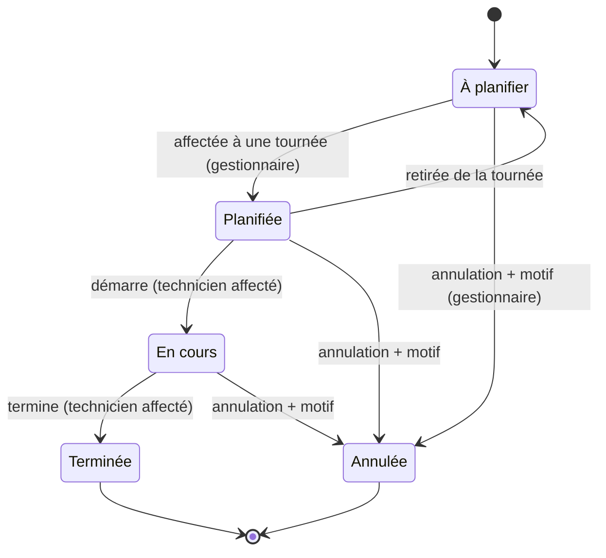
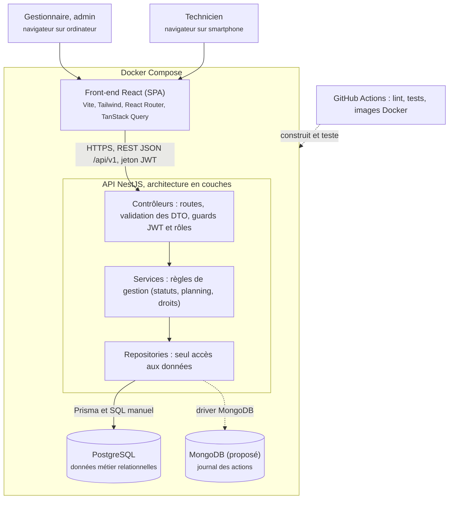

# Cahier des charges — Plumbly

23 novembre 2026 · Loïc BOTSY, Arnaud BIDEL

## 1. Présentation du projet

Plumbly est un progiciel web qui permet à une entreprise de plomberie de planifier, répartir et suivre les tournées de ses techniciens. Ce document sert de référence au binôme et au jury ; il sera ajusté au fil du développement.

### 1.1 Contexte

Une entreprise de plomberie de 3 à 20 techniciens reçoit chaque jour des demandes d'intervention par téléphone ou par e-mail : fuites, débouchages, remplacements de chauffe-eau, entretiens. Le gestionnaire les note, puis les répartit entre les plombiers selon leur disponibilité, leur secteur et l'urgence.

Aujourd'hui, cette organisation repose souvent sur un agenda papier, un tableur ou des messages. Les conséquences sont connues : doubles réservations, urgences mal placées, trajets inutiles, informations client perdues et aucun historique fiable.

### 1.2 Problème à résoudre

- Le gestionnaire n'a pas de vue d'ensemble de la charge de chaque technicien.
- Le technicien ne connaît pas toujours l'ordre de sa tournée ni le détail des interventions.
- L'entreprise ne peut pas mesurer son activité : nombre d'interventions, délais, répartition par technicien.

### 1.3 Objectifs

| Objectif | Indicateur de réussite |
| --- | --- |
| Centraliser les clients, techniciens et interventions | 100 % des interventions saisies dans Plumbly |
| Planifier les tournées sans conflit | Aucun technicien affecté à deux interventions sur le même créneau |
| Donner au technicien sa tournée du jour sur mobile | Tournée consultable en moins de 3 clics après connexion |
| Suivre l'avancement en temps réel | Statut de chaque intervention à jour en fin de journée |
| Mesurer l'activité | Tableau de bord avec au moins 3 indicateurs |

### 1.4 Équipe projet

| Membre | Rôle principal |
| --- | --- |
| Loïc BOTSY | Cahier des charges, UML, tests, CI ; authentification et interventions (front et back) |
| Arnaud BIDEL | Modélisation des données, maquettes, Docker ; clients, techniciens et tournées (front et back) |

Projet réalisé dans le cadre de la formation CDA9 (titre professionnel Concepteur Développeur d'Applications).

## 2. Acteurs et personas

Trois rôles utilisent Plumbly : l'administrateur, le gestionnaire et le technicien. Chaque rôle a des droits distincts (voir 5.5).

| Acteur | Description | Usage principal | Support |
| --- | --- | --- | --- |
| Administrateur | Gérant de l'entreprise | Crée les comptes, configure l'entreprise, consulte les statistiques | Ordinateur |
| Gestionnaire | Secrétaire ou responsable planning | Saisit les demandes, gère clients et techniciens, planifie les tournées | Ordinateur |
| Technicien | Plombier sur le terrain | Consulte sa tournée, met à jour le statut des interventions | Smartphone |

### 2.1 Persona gestionnaire : Sophie, 42 ans

Sophie gère le planning d'une entreprise de 8 plombiers. Elle reçoit 15 à 30 appels par jour et jongle entre un agenda papier et un tableur.

- **Besoins** : voir d'un coup d'œil qui est disponible, insérer une urgence sans tout casser, retrouver l'historique d'un client.
- **Frustrations** : les doubles réservations, les plombiers qui appellent pour demander leur prochaine adresse.
- **Aisance numérique** : moyenne, utilise quotidiennement un ordinateur.

### 2.2 Persona technicien : Karim, 31 ans

Karim est plombier depuis 10 ans. Il réalise 4 à 8 interventions par jour et passe sa journée en camionnette.

- **Besoins** : connaître sa tournée dès le matin, avoir l'adresse, le téléphone du client et la nature du problème, signaler qu'une intervention est terminée.
- **Frustrations** : les informations incomplètes, les changements de planning non communiqués.
- **Aisance numérique** : utilise son smartphone, peu de temps et souvent avec des gants.

### 2.3 Persona administrateur : Michel, 55 ans

Michel est le gérant. Il veut suivre l'activité sans entrer dans le détail du planning.

- **Besoins** : nombre d'interventions par période et par technicien, interventions en retard, gestion des comptes.
- **Frustrations** : aucune donnée fiable pour piloter l'entreprise.

## 3. Périmètre

Le MVP livré en deux semaines couvre l'authentification, la gestion des clients, des techniciens et des interventions, la planification des tournées et un tableau de bord simple. Le reste est prévu en évolution.

### 3.1 Inclus dans le MVP

- Authentification et gestion des rôles (administrateur, gestionnaire, technicien)
- Gestion des clients et de leurs adresses d'intervention
- Gestion des techniciens et de leurs disponibilités
- Création et suivi des interventions avec statuts
- Planification des tournées : affectation et ordre des interventions
- Vue planning jour / semaine par technicien
- Vue « ma tournée du jour » sur mobile pour le technicien
- Tableau de bord : indicateurs d'activité calculés en SQL
- Journal des actions (historique des changements de statut)

### 3.2 Évolutions envisagées

- Carte des interventions et optimisation automatique de l'ordre de tournée (API de géolocalisation)
- Notifications par e-mail ou SMS au client (rappel, arrivée du technicien)
- Rapport d'intervention avec photos et signature du client
- Gestion des devis et des factures
- Gestion du stock de pièces dans les camionnettes
- Application mobile installable (PWA) avec mode hors ligne

### 3.3 Hors périmètre

- Paiement en ligne
- Comptabilité et paie
- Portail de prise de rendez-vous par le client final
- Gestion multi-entreprises (une instance = une entreprise)

## 4. Besoins fonctionnels

Les besoins sont exprimés en user stories, priorisées selon la méthode MoSCoW : M = Must (MVP), S = Should, C = Could, W = Won't (pas pour cette version).

### 4.1 Authentification et comptes

| ID | User story | Priorité | Critères d'acceptation |
| --- | --- | --- | --- |
| US01 | En tant qu'utilisateur, je veux me connecter avec mon e-mail et mon mot de passe afin d'accéder à mon espace. | M | Identifiants invalides = message générique ; redirection selon le rôle |
| US02 | En tant qu'utilisateur, je veux me déconnecter afin de sécuriser ma session. | M | Le jeton est invalidé côté client ; retour à la page de connexion |
| US03 | En tant qu'administrateur, je veux créer, modifier et désactiver des comptes afin de gérer l'accès à l'application. | M | Un compte désactivé ne peut plus se connecter |
| US04 | En tant qu'utilisateur, je veux réinitialiser mon mot de passe afin de retrouver l'accès à mon compte. | S | Lien à usage unique, valable 30 minutes |
| US05 | En tant qu'utilisateur, je veux consulter et modifier mes informations afin de les garder à jour. | C | Changement de mot de passe avec saisie de l'ancien |

### 4.2 Clients

| ID | User story | Priorité | Critères d'acceptation |
| --- | --- | --- | --- |
| US06 | En tant que gestionnaire, je veux créer un client avec ses coordonnées afin de l'associer à des interventions. | M | Nom et téléphone obligatoires ; e-mail au bon format |
| US07 | En tant que gestionnaire, je veux ajouter plusieurs adresses d'intervention à un client afin de gérer ses différents logements. | M | Au moins une adresse par client |
| US08 | En tant que gestionnaire, je veux rechercher un client par nom, téléphone ou ville afin de le retrouver rapidement. | M | Résultats paginés, recherche insensible à la casse |
| US09 | En tant que gestionnaire, je veux consulter l'historique des interventions d'un client afin de connaître ses antécédents. | S | Liste triée de la plus récente à la plus ancienne |
| US10 | En tant que gestionnaire, je veux modifier ou archiver un client afin de garder une base à jour. | M | Un client archivé n'apparaît plus dans les listes mais reste dans l'historique |

### 4.3 Techniciens

| ID | User story | Priorité | Critères d'acceptation |
| --- | --- | --- | --- |
| US11 | En tant que gestionnaire, je veux créer une fiche technicien liée à un compte afin de lui affecter des interventions. | M | Un technicien = un compte de rôle technicien |
| US12 | En tant que gestionnaire, je veux saisir les indisponibilités d'un technicien (congés, absence) afin de ne pas le planifier à tort. | M | Une affectation sur une indisponibilité est refusée |
| US13 | En tant que gestionnaire, je veux renseigner les compétences d'un technicien afin de choisir le bon profil. | C | Filtre par compétence lors de l'affectation |

### 4.4 Interventions

| ID | User story | Priorité | Critères d'acceptation |
| --- | --- | --- | --- |
| US14 | En tant que gestionnaire, je veux créer une intervention (client, adresse, type, description, urgence, durée estimée) afin d'enregistrer une demande. | M | Statut initial « à planifier » |
| US15 | En tant que gestionnaire, je veux filtrer les interventions par statut, urgence, technicien et date afin de prioriser mon travail. | M | Filtres combinables |
| US16 | En tant que gestionnaire, je veux modifier ou annuler une intervention afin de suivre les changements du client. | M | Motif obligatoire en cas d'annulation |
| US17 | En tant que technicien, je veux passer une intervention à « en cours » puis « terminée » afin d'informer le gestionnaire. | M | Seules les transitions autorisées sont possibles (voir 5.1) |
| US18 | En tant que technicien, je veux ajouter un compte rendu à une intervention terminée afin de tracer ce qui a été fait. | S | Texte libre, 2 000 caractères maximum |
| US19 | En tant que gestionnaire, je veux voir l'historique des changements de statut afin de savoir qui a fait quoi et quand. | S | Date, auteur, ancien et nouveau statut |

### 4.5 Tournées et planning

| ID | User story | Priorité | Critères d'acceptation |
| --- | --- | --- | --- |
| US20 | En tant que gestionnaire, je veux créer la tournée d'un technicien pour une date afin d'organiser sa journée. | M | Une seule tournée par technicien et par jour |
| US21 | En tant que gestionnaire, je veux affecter une intervention à une tournée sur un créneau afin de la planifier. | M | Conflit de créneau ou indisponibilité = refus avec message explicite |
| US22 | En tant que gestionnaire, je veux réordonner les interventions d'une tournée afin d'optimiser les trajets. | M | Ordre enregistré et visible par le technicien |
| US23 | En tant que gestionnaire, je veux voir le planning de tous les techniciens par jour et par semaine afin de repérer les créneaux libres. | M | Vue jour et vue semaine, filtre par technicien |
| US24 | En tant que technicien, je veux voir ma tournée du jour sur mon téléphone afin de savoir où aller. | M | Ordre, horaire, adresse cliquable (ouvre l'application de navigation), téléphone cliquable |
| US25 | En tant que gestionnaire, je veux insérer une urgence dans une tournée déjà planifiée afin de réagir rapidement. | S | Les interventions suivantes sont décalées et signalées |

### 4.6 Tableau de bord

| ID | User story | Priorité | Critères d'acceptation |
| --- | --- | --- | --- |
| US26 | En tant qu'administrateur, je veux voir le nombre d'interventions par statut et par technicien sur une période afin de suivre l'activité. | M | Période paramétrable ; requête SQL écrite à la main |
| US27 | En tant qu'administrateur, je veux connaître le délai moyen entre la demande et la réalisation afin de mesurer la réactivité. | S | Délai en heures, par type d'intervention |
| US28 | En tant que gestionnaire, je veux voir les interventions en retard ou non planifiées depuis plus de 48 h afin de les traiter en priorité. | S | Liste triée par ancienneté |
| US29 | En tant qu'administrateur, je veux exporter la liste des interventions en CSV afin de l'exploiter ailleurs. | C | Export filtré selon la vue courante |

## 5. Règles de gestion

Ces règles sont appliquées côté API (couche service) et vérifiées par les tests unitaires et d'intégration. Le front-end les répète seulement pour le confort de l'utilisateur.

### 5.1 Cycle de vie d'une intervention

*Seul le technicien affecté démarre et termine une intervention ; « Terminée » et « Annulée » sont définitives.*

| ID | Règle |
| --- | --- |
| RG01 | Une intervention est créée au statut « à planifier ». |
| RG02 | Elle passe à « planifiée » uniquement lorsqu'elle est affectée à une tournée sur un créneau. |
| RG03 | Seul le technicien affecté peut la passer à « en cours », puis à « terminée ». |
| RG04 | Une intervention « planifiée » retirée de sa tournée revient à « à planifier ». |
| RG05 | Une intervention peut être « annulée » par un gestionnaire tant qu'elle n'est pas « terminée » ; le motif est obligatoire. |
| RG06 | Une intervention « terminée » ou « annulée » n'est plus modifiable. |
| RG07 | Chaque changement de statut est historisé : date, auteur, ancien et nouveau statut. |

### 5.2 Planification

| ID | Règle |
| --- | --- |
| RG08 | Un technicien a au plus une tournée par jour. |
| RG09 | Deux interventions d'un même technicien ne peuvent pas se chevaucher (heure de début + durée estimée). |
| RG10 | On ne peut pas planifier un technicien sur une période d'indisponibilité. |
| RG11 | Les créneaux sont compris entre 7 h 00 et 19 h 00, du lundi au samedi (paramètre à confirmer). |
| RG12 | Une tournée ne peut pas être créée pour une date passée. |
| RG13 | L'ordre des interventions dans une tournée est un entier unique par tournée, à partir de 1. |

### 5.3 Urgences

| ID | Règle |
| --- | --- |
| RG14 | Une intervention a un niveau d'urgence : normale, prioritaire ou urgente. |
| RG15 | Les interventions urgentes apparaissent en tête des listes « à planifier ». |
| RG16 | Une intervention urgente non planifiée depuis plus de 4 h est signalée sur le tableau de bord. |

### 5.4 Clients et données

| ID | Règle |
| --- | --- |
| RG17 | Un client a au moins une adresse d'intervention. |
| RG18 | Un client ou un technicien lié à des interventions n'est jamais supprimé : il est archivé. |
| RG19 | L'e-mail d'un compte utilisateur est unique. |

### 5.5 Droits par rôle

| Action | Administrateur | Gestionnaire | Technicien |
| --- | --- | --- | --- |
| Gérer les comptes utilisateurs | Oui | Non | Non |
| Gérer clients et techniciens | Oui | Oui | Non |
| Créer et modifier des interventions | Oui | Oui | Non |
| Planifier les tournées | Oui | Oui | Non |
| Voir le planning de tous | Oui | Oui | Non |
| Voir sa propre tournée | — | — | Oui |
| Changer le statut de ses interventions | Non | Non | Oui |
| Consulter le tableau de bord | Oui | Oui (partiel) | Non |

## 6. Besoins non fonctionnels

L'application doit être sécurisée dès la conception, conforme au RGPD, accessible et utilisable sur mobile par les techniciens.

### 6.1 Sécurité

Les mesures suivent le [Top 10 OWASP](https://owasp.org/www-project-top-ten/) et les recommandations de l'ANSSI.

| Risque | Mesure prévue |
| --- | --- |
| Contrôle d'accès défaillant | Guards NestJS sur chaque route : authentification JWT puis vérification du rôle ; un technicien n'accède qu'à ses propres données |
| Stockage des mots de passe | Hachage avec argon2 (ou bcrypt) ; jamais de mot de passe en clair ni dans les logs |
| Politique de mot de passe | 12 caractères minimum, majuscule, minuscule, chiffre et caractère spécial |
| Force brute | Limitation du nombre de tentatives de connexion (`@nestjs/throttler`) |
| Injection SQL | Requêtes Prisma paramétrées ; requêtes SQL manuelles avec `$queryRaw` et paramètres liés, jamais de concaténation |
| Entrées invalides | Validation de tous les DTO avec class-validator ; rejet des champs inconnus (`whitelist`) |
| XSS | Pas de `dangerouslySetInnerHTML` ; React échappe l'affichage ; en-têtes de sécurité avec Helmet |
| CSRF et vol de session | Jeton d'accès de courte durée (15 min) et jeton de rafraîchissement en cookie `httpOnly`, `Secure`, `SameSite=Strict` |
| Configuration | CORS limité à l'origine du front ; secrets dans des variables d'environnement, jamais dans le dépôt |
| Dépendances vulnérables | `npm audit` et Dependabot sur le dépôt GitHub |
| Traçabilité | Journalisation des connexions et des actions sensibles (création de compte, annulation) |

### 6.2 RGPD

- **Données personnelles traitées** : nom, téléphone, e-mail et adresse des clients ; identité et planning des techniciens.
- **Minimisation** : seules les données nécessaires à l'intervention sont collectées.
- **Durée de conservation** : données client conservées 3 ans après la dernière intervention, puis anonymisées (durée à valider).
- **Droits des personnes** : export et anonymisation d'un client sur demande (droit d'accès et d'effacement).
- **Registre des traitements** et mentions légales accessibles depuis l'application.
- **Données de test** : uniquement des données fictives (seed), jamais de vraies données clients.

### 6.3 Accessibilité et ergonomie

- Respect des critères essentiels du [RGAA](https://accessibilite.numerique.gouv.fr/) (WCAG 2.1 niveau AA) : contrastes, navigation au clavier, libellés de formulaires, textes alternatifs.
- Zones tactiles d'au moins 44 × 44 px sur la vue technicien.
- Messages d'erreur clairs, indiquant comment corriger.

### 6.4 Performance et disponibilité

- Temps de réponse de l'API inférieur à 500 ms pour 95 % des requêtes courantes.
- Premier affichage de la tournée du jour en moins de 2 s sur une connexion 4G.
- Listes paginées (20 éléments par page par défaut).
- Sauvegarde quotidienne de la base PostgreSQL.

### 6.5 Compatibilité

- Navigateurs : deux dernières versions de Chrome, Firefox, Edge et Safari.
- Responsive : mobile (≥ 360 px), tablette et ordinateur ; la vue technicien est pensée mobile d'abord.
- Langue : interface en français.

### 6.6 Maintenabilité

- Code en TypeScript strict, côté front et back.
- ESLint et Prettier appliqués par la CI.
- Conventions de commit ([Conventional Commits](https://www.conventionalcommits.org/fr/)) et relecture obligatoire des pull requests.
- Documentation de l'API générée avec Swagger (OpenAPI).

## 7. Maquettage et ergonomie

Les maquettes sont réalisées dans Figma par Arnaud, en trois étapes : zoning, wireframes, puis maquettes haute fidélité. Le lien Figma sera ajouté ici et dans le README.

### 7.1 Liste des écrans

| Écran | Rôles | Support prioritaire | User stories |
| --- | --- | --- | --- |
| Connexion / mot de passe oublié | Tous | Mobile et ordinateur | US01, US04 |
| Tableau de bord | Administrateur, gestionnaire | Ordinateur | US26 à US28 |
| Liste et fiche client | Administrateur, gestionnaire | Ordinateur | US06 à US10 |
| Liste et fiche technicien | Administrateur, gestionnaire | Ordinateur | US11 à US13 |
| Liste et fiche intervention | Administrateur, gestionnaire | Ordinateur | US14 à US16, US19 |
| Planning jour / semaine | Administrateur, gestionnaire | Ordinateur | US20 à US23, US25 |
| Ma tournée du jour | Technicien | Mobile | US24 |
| Détail d'intervention (terrain) | Technicien | Mobile | US17, US18 |
| Gestion des comptes | Administrateur | Ordinateur | US03 |
| Mon profil | Tous | Mobile et ordinateur | US05 |

### 7.2 Charte graphique (à compléter par Arnaud)

- **Couleurs** : une couleur principale (bleu « eau »), une couleur d'accent pour les urgences, des couleurs de statut cohérentes sur tous les écrans.
- **Typographie** : une police sans empattement lisible sur mobile (par exemple Inter).
- **Composants** : boutons, champs, badges de statut, cartes d'intervention, tableaux, modales, définis une fois dans Figma puis dans Tailwind.

### 7.3 Principes d'ergonomie

- Mobile d'abord pour la vue technicien : grandes zones tactiles, informations essentielles en haut.
- Statut et urgence toujours visibles par une couleur **et** un libellé (accessibilité).
- Trois clics maximum pour accéder à une information clé.
- Confirmation avant toute action destructrice (annulation, archivage).

## 8. Architecture technique

Plumbly est une application web en trois tiers : un front-end React (SPA), une API REST NestJS organisée en couches et une base PostgreSQL, le tout conteneurisé avec Docker.

Le front ne parle qu'à l'API ; seule la couche repository accède aux bases, ce qui garde les règles de gestion indépendantes du stockage.

### 8.1 Stack

| Couche | Technologie | Justification |
| --- | --- | --- |
| Front-end | React + TypeScript, Vite | Écosystème riche, composants réutilisables, build rapide |
| Style | Tailwind CSS | Charte appliquée via la configuration, responsive simple |
| Routing et données front | React Router, TanStack Query (proposé) | Routes protégées, cache et rechargement des données de l'API |
| Formulaires | React Hook Form + Zod (proposé) | Validation côté client typée |
| Back-end | NestJS (Node.js, TypeScript) | Architecture modulaire en couches, injection de dépendances, guards, tests intégrés |
| ORM | Prisma | Schéma déclaratif, migrations versionnées, client typé |
| SQL manuel | `$queryRaw` / `$executeRaw` de Prisma | Requêtes de reporting, jointures et agrégations maîtrisées |
| Base relationnelle | PostgreSQL | Fiable, transactions, contraintes d'intégrité, open source |
| Base NoSQL | MongoDB (proposé) | Journal des actions et historique des statuts, documents sans schéma fixe |
| Authentification | Passport + JWT, argon2 | Standard NestJS, hachage robuste |
| Documentation API | Swagger (OpenAPI) | Générée depuis les décorateurs NestJS |
| Conteneurs | Docker, Docker Compose | Environnement identique pour le binôme, la CI et la production |
| CI/CD | GitHub Actions | Intégré au dépôt et au GitHub Project |

### 8.2 Architecture en couches de l'API

Chaque module métier NestJS (auth, users, clients, technicians, interventions, tours, dashboard) suit la même organisation :

1. **Contrôleur** : reçoit la requête HTTP, valide le DTO, applique les guards, renvoie la réponse.
2. **Service** : porte les règles de gestion (section 5) ; ne connaît ni HTTP ni SQL.
3. **Repository** : accède aux données via Prisma ou en SQL manuel ; seul point de contact avec la base.
4. **Modèle / DTO** : objets d'entrée et de sortie, séparés des entités de la base.

Cette séparation permet de tester chaque couche isolément et de changer la source de données sans toucher au métier.

### 8.3 API REST

- Préfixe `/api/v1`, ressources au pluriel : `/clients`, `/technicians`, `/interventions`, `/tours`, `/dashboard`.
- Verbes HTTP standard et codes de retour cohérents (200, 201, 204, 400, 401, 403, 404, 409 pour un conflit de planning).
- Format d'erreur unique : `{ statusCode, message, error }`.
- Pagination : `?page=1&limit=20`, filtres en paramètres de requête.

### 8.4 Données SQL et NoSQL

- **PostgreSQL** stocke les données métier structurées et liées : utilisateurs, clients, adresses, techniciens, interventions, tournées.
- **MongoDB** stockerait le journal des actions (qui a fait quoi, quand, avec quelles données avant et après). Ces documents sont nombreux, s'ajoutent sans jamais être modifiés et ont une structure variable selon l'action.

Ce choix est à valider (voir section 14) : il couvre la compétence « composants d'accès aux données SQL et NoSQL » du titre CDA.

## 9. Modèle de données

Le modèle comporte 8 entités relationnelles. C'est une première version : Arnaud la détaillera dans le MCD et le MLD (méthode Merise), puis dans `schema.prisma`.

### 9.1 Entités principales

| Entité | Attributs principaux | Relations |
| --- | --- | --- |
| Utilisateur | id, e-mail (unique), mot de passe haché, nom, prénom, rôle, actif, créé le | 0 ou 1 technicien |
| Technicien | id, téléphone, couleur planning, compétences, archivé | 1 utilisateur ; 0 à n indisponibilités ; 0 à n tournées |
| Indisponibilité | id, début, fin, motif | 1 technicien |
| Client | id, type (particulier / professionnel), nom, prénom, raison sociale, téléphone, e-mail, archivé | 1 à n adresses ; 0 à n interventions |
| Adresse | id, rue, complément, code postal, ville, informations d'accès (code, étage) | 1 client ; 0 à n interventions |
| Intervention | id, type, description, urgence, statut, durée estimée, créneau prévu, ordre dans la tournée, compte rendu, motif d'annulation, créée le, terminée le | 1 client ; 1 adresse ; 0 ou 1 tournée ; 1 créateur |
| Tournée | id, date | 1 technicien ; 0 à n interventions ; unique par (technicien, date) |
| Type d'intervention | id, libellé, durée par défaut | 0 à n interventions |

Côté NoSQL, la collection **journal\_actions** contiendrait un document par action : date, utilisateur, type d'action, entité concernée et données avant / après.

### 9.2 Contraintes d'intégrité

- Clés étrangères avec suppression restreinte : on archive au lieu de supprimer (RG18).
- Contrainte d'unicité sur (technicien, date) pour les tournées (RG08) et sur (tournée, ordre) pour les interventions (RG13).
- Statut, urgence et rôle stockés sous forme d'énumérations PostgreSQL.
- Index sur les colonnes filtrées souvent : statut, date de tournée, nom du client, ville.

### 9.3 Requêtes SQL écrites à la main

Quelques requêtes seront écrites en SQL brut pour le dossier professionnel :

- nombre d'interventions par technicien et par statut sur une période (`GROUP BY`, agrégation) ;
- tournée détaillée d'un technicien avec client et adresse (jointures) ;
- délai moyen entre création et fin d'intervention par type (calcul sur dates) ;
- interventions non planifiées depuis plus de 48 h (sous-requête ou filtre sur intervalle) ;
- une transaction : réordonner les interventions d'une tournée sans violer la contrainte d'unicité.

Un jeu de données fictif (seed) d'environ 5 techniciens, 50 clients et 200 interventions servira aux tests et à la démonstration.

## 10. Stratégie de tests

Les tests d'intégration de l'API sont écrits dès la semaine 1, à partir des user stories, avant le développement : ils échouent au départ puis passent au vert au fil de la semaine 2. Aucune pull request n'est fusionnée si la CI est rouge.

### 10.1 Niveaux de tests

| Niveau | Ce qui est testé | Outils | Objectif |
| --- | --- | --- | --- |
| Unitaire back | Services et règles de gestion (statuts, conflits de planning, droits) | Jest, `@nestjs/testing`, mocks des repositories | 80 % de couverture sur les services |
| Unitaire front | Composants, formulaires, hooks | Vitest, React Testing Library | Composants critiques couverts |
| Intégration back | Routes de l'API de bout en bout, avec une vraie base | Jest, Supertest, Testcontainers (PostgreSQL) | Chaque user story Must couverte |
| Intégration front | Écrans branchés sur une API simulée | Vitest, MSW | Parcours principaux |
| End-to-end (optionnel) | Parcours complets dans un vrai navigateur | Playwright | Connexion, création et planification d'une intervention |
| Sécurité | Accès refusés, injections, entrées invalides | Tests d'intégration dédiés, `npm audit` | Aucune faille connue critique |
| Recette | Validation manuelle des user stories | Cahier de recette | 100 % des Must validées |

### 10.2 Exemples de cas de test d'intégration

| ID | Scénario | Résultat attendu |
| --- | --- | --- |
| TI01 | Connexion avec un mot de passe erroné | 401, message générique |
| TI02 | Un technicien appelle `GET /clients` | 403 |
| TI03 | Création d'une intervention valide | 201, statut « à planifier » |
| TI04 | Affectation sur un créneau déjà occupé | 409, message de conflit |
| TI05 | Affectation pendant une indisponibilité | 409 |
| TI06 | Passage de « à planifier » directement à « terminée » | 400, transition interdite |
| TI07 | Un technicien termine l'intervention d'un collègue | 403 |
| TI08 | Annulation sans motif | 400 |
| TI09 | Tableau de bord sur une période | 200, totaux cohérents avec le seed |
| TI10 | Recherche client avec `' OR 1=1 --` | 200, aucun résultat inattendu |

### 10.3 Organisation

- Base de test créée à la volée par Testcontainers, migrations Prisma appliquées, puis seed dédié aux tests.
- Commandes : `npm run test` (unitaires), `npm run test:e2e` (intégration), `npm run test:cov` (couverture).
- Le plan de tests et le cahier de recette sont ajoutés dans `docs/`.

## 11. Déploiement et DevOps

Chaque pull request déclenche la CI ; chaque fusion sur `main` produit des images Docker prêtes à déployer. L'hébergeur de production reste à choisir (voir section 14).

### 11.1 Environnements

| Environnement | Usage | Base de données | Lancement |
| --- | --- | --- | --- |
| Développement | Poste de chaque membre du binôme | PostgreSQL (et MongoDB) dans Docker, données de seed | `docker compose up` |
| Test | CI GitHub Actions | Conteneurs éphémères (Testcontainers) | À chaque pull request |
| Production | Démonstration au jury | Base dédiée, sauvegardée chaque jour | Déploiement depuis `main` |

### 11.2 Pipeline CI/CD (GitHub Actions)

1. Installation des dépendances (avec cache npm).
2. Lint (ESLint) et vérification du formatage (Prettier).
3. Vérification des types TypeScript et build du front et du back.
4. Tests unitaires, puis tests d'intégration avec rapport de couverture.
5. Audit des dépendances (`npm audit`).
6. Sur `main` uniquement : construction des images Docker et publication sur GitHub Container Registry.
7. Déploiement en production (manuel ou automatique selon l'hébergeur choisi).

### 11.3 Gestion du code

- Branche `main` protégée : fusion uniquement par pull request, CI verte et relecture de l'autre membre du binôme.
- Une branche par issue, créée depuis le GitHub Project (`12-ecrire-tests-integration`).
- Messages de commit au format Conventional Commits (`feat:`, `fix:`, `test:`, `docs:`).
- Versions identifiées par des tags (`v0.1.0` pour le MVP).

### 11.4 Documentation du déploiement

- `README.md` : installation, variables d'environnement, commandes.
- `.env.example` : liste de toutes les variables sans leurs valeurs secrètes.
- `docs/deploiement.md` : procédure de mise en production, de sauvegarde et de restauration de la base.
- Documentation Swagger de l'API accessible sur `/api/docs` en développement.

## 12. Gestion de projet

Le projet suit une méthode agile inspirée de Kanban, sur deux semaines : une semaine de conception, une semaine de développement du MVP. Les 24 tâches sont suivies dans le [GitHub Project du dépôt](https://github.com/users/Falkor555/projects/6).

### 12.1 Organisation

- **Kanban** : Backlog → To do → In progress → In review → Done.
- **Une card = une issue = une branche = une pull request** ; `Closes #n` dans la pull request ferme l'issue.
- **Point quotidien** de 10 minutes : ce qui est fait, ce qui est prévu, ce qui bloque.
- **Relecture croisée** : chaque pull request est relue par l'autre membre du binôme.
- **Outils** : GitHub (code, issues, Project, Actions), Figma (maquettes), Discord ou Teams (communication).

### 12.2 Planning

| Période | Jalon | Contenu |
| --- | --- | --- |
| Semaine 1, J1–J2 | Besoins définis | Cahier des charges, personas, user stories, MCD / MLD, UML |
| Semaine 1, J2–J4 | Maquettes validées | Zoning, wireframes, maquettes haute fidélité |
| Semaine 1, J3–J5 | Socle technique prêt | Docker, NestJS + Prisma, React + Vite + Tailwind, CI, outils de test, tests d'intégration écrits |
| Semaine 2, J6–J9 | MVP développé | Authentification, clients, techniciens, interventions, tournées, planning, requêtes SQL |
| Semaine 2, J10 | MVP livré (`v0.1.0`) | Recette, corrections, README, préparation de la démo et du dossier |

### 12.3 Répartition

La répartition suit les cards du [GitHub Project](https://github.com/users/Falkor555/projects/6). En semaine 2, chaque membre développe ses fonctionnalités **de bout en bout** : API NestJS, accès aux données et écrans React. Ainsi, chacun peut présenter à l'oral du front-end, du back-end et de la base de données.

| Domaine | Loïc BOTSY | Arnaud BIDEL |
| --- | --- | --- |
| Analyse et conception | Cahier des charges (#1), personas et user stories (#2), diagrammes UML (#3) | MCD et MLD (#4) |
| Maquettage | — | Zoning et wireframes (#5), maquettes et charte graphique (#6) |
| Socle technique | React, Vite et Tailwind (#9), CI GitHub Actions (#10) | Monorepo et docker-compose (#7), NestJS et Prisma (#8) |
| Tests (semaine 1) | Environnement de test (#11), tests d'intégration de l'API (#12) | — |
| Back-end (semaine 2) | Authentification et rôles (#13), CRUD interventions et statuts (#17) | CRUD clients et techniciens (#15), planification des tournées (#19) |
| Front-end (semaine 2) | Connexion et routes protégées (#14), écrans des interventions (#18) | Écrans clients et techniciens (#16), vue planning (#20) |
| En commun | Requêtes SQL manuelles (#21), tests unitaires (#22), recette (#23), README, démo et dossier (#24) | Idem |

| Période | Loïc BOTSY | Arnaud BIDEL |
| --- | --- | --- |
| Semaine 2, J6–J7 | Authentification : API (#13) et écrans (#14) | Clients et techniciens : API (#15) et écrans (#16) |
| Semaine 2, J8–J9 | Interventions : API (#17) et écrans (#18) | Tournées et planning : API (#19) et écrans (#20) |
| Semaine 2, J9 | Requêtes SQL de son domaine (#21) | Requêtes SQL de son domaine (#21) |
| Semaine 2, J10 | Recette, README, démo (#23, #24) | Recette, README, démo (#23, #24) |

Points d'attention :

- Le module d'authentification (#13) est utilisé par tous les autres. Ses guards seront livrés en premier, dès J6 ; d'ici là, Arnaud peut développer ses routes sans les guards.
- La planification (#19) s'appuie sur le modèle des interventions, déjà défini dans le schéma Prisma dès la semaine 1 (#8). Les deux membres doivent se mettre d'accord sur le service des interventions dès J8.

### 12.4 Livrables

- [ ] Cahier des charges (ce document)
- [ ] User stories, diagrammes UML, MCD et MLD
- [ ] Maquettes Figma
- [ ] Code source sur GitHub avec README
- [ ] Plan de tests et cahier de recette
- [ ] Application déployée et démontrable
- [ ] Documentation de déploiement
- [ ] Dossier de projet et support de présentation

### 12.5 Risques

| Risque | Conséquence | Parade |
| --- | --- | --- |
| Délai de deux semaines très court | MVP incomplet | Prioriser les Must, reporter les Should et Could |
| Planification plus complexe que prévu | Retard sur le cœur du produit | Commencer par une affectation simple sans calcul d'itinéraire |
| Dépendance entre front et back | Blocage du front | Contrat d'API défini tôt (Swagger), API simulée avec MSW |
| Absence d'un membre | Retard | Relecture croisée pour que chacun connaisse tout le code |

## 13. Correspondance avec le titre CDA

Plumbly couvre les 11 compétences des trois CCP du titre Concepteur Développeur d'Applications. Les intitulés ci-dessous sont repris de mémoire et sont à vérifier avec le REAC fourni par la formation.

### CCP 1 : Développer une application sécurisée

| Compétence | Où elle est démontrée dans Plumbly | Sections |
| --- | --- | --- |
| Installer et configurer son environnement de travail en fonction du projet | Docker Compose, Node, ESLint / Prettier, variables d'environnement, Git et GitHub | 8.1, 11.1 |
| Développer des interfaces utilisateur | Front React + Tailwind responsive et accessible, formulaires validés, vue mobile technicien | 6.3, 7 |
| Développer des composants métier | Services NestJS portant les règles de gestion : statuts, conflits de planning, droits | 5, 8.2 |
| Contribuer à la gestion d'un projet informatique | Kanban GitHub Project, issues, branches, pull requests, relecture croisée, planning | 12 |

### CCP 2 : Concevoir et développer une application sécurisée organisée en couches

| Compétence | Où elle est démontrée dans Plumbly | Sections |
| --- | --- | --- |
| Analyser les besoins et maquetter une application | Cahier des charges, personas, user stories, zoning, wireframes, maquettes Figma | 2, 4, 7 |
| Définir l'architecture logicielle d'une application | Architecture trois tiers, API REST en couches (contrôleur, service, repository), diagrammes UML | 8 |
| Concevoir et mettre en place une base de données relationnelle | MCD / MLD Merise, schéma Prisma, migrations, contraintes d'intégrité, index, seed | 9 |
| Développer des composants d'accès aux données SQL et NoSQL | Repositories Prisma, requêtes SQL manuelles et transaction, journal des actions dans MongoDB | 8.4, 9.3 |

### CCP 3 : Préparer le déploiement d'une application sécurisée

| Compétence | Où elle est démontrée dans Plumbly | Sections |
| --- | --- | --- |
| Préparer et exécuter les plans de tests d'une application | Plan de tests, tests unitaires et d'intégration, tests de sécurité, cahier de recette | 10 |
| Préparer et documenter le déploiement d'une application | README, `.env.example`, procédure de déploiement, Swagger | 11.4 |
| Contribuer à la mise en production dans une démarche DevOps | Pipeline GitHub Actions, images Docker, déploiement depuis `main` | 11.2 |

La sécurité, transversale aux trois CCP, est traitée en section 6.1 et vérifiée par les tests de la section 10.

## 14. Points à décider et glossaire

### 14.1 Points à décider

- [ ] Base NoSQL : MongoDB pour le journal des actions, ou autre usage (Redis pour le cache) ?
- [ ] Hébergement de production : VPS avec Docker, Render, Railway ou autre ?
- [ ] Horaires et jours ouvrés paramétrables (RG11) ?
- [ ] Durée de conservation des données client (6.2) ?
- [ ] Liste des types d'intervention et durées par défaut
- [ ] Lien Figma des maquettes

### 14.2 Glossaire

| Terme | Définition |
| --- | --- |
| Intervention | Déplacement d'un technicien chez un client pour un problème donné |
| Tournée | Ensemble ordonné des interventions d'un technicien sur une journée |
| Créneau | Heure de début prévue et durée estimée d'une intervention |
| Indisponibilité | Période où un technicien ne peut pas être planifié |
| MVP | Minimum Viable Product : première version livrable avec les fonctions essentielles |
| MoSCoW | Méthode de priorisation : Must, Should, Could, Won't |
| ORM | Outil qui fait le lien entre le code et la base de données relationnelle (ici Prisma) |
| DTO | Data Transfer Object : objet décrivant les données échangées par l'API |
| JWT | JSON Web Token : jeton signé qui prouve l'identité de l'utilisateur |
| CI/CD | Intégration et déploiement continus |
| REAC | Référentiel emploi activités compétences du titre professionnel |
| CCP | Certificat de compétences professionnelles, bloc du titre CDA |
