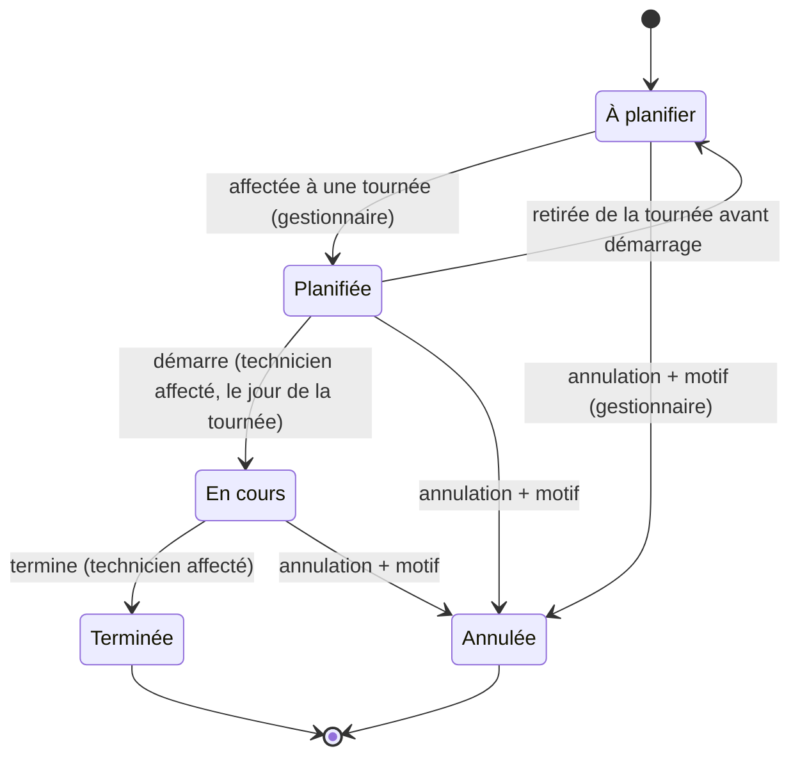
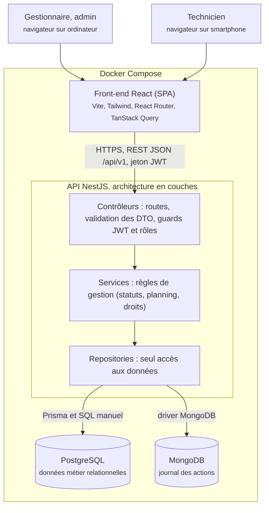

# Cahier des charges — Plumbly

23 novembre 2026 · Loïc BOTSY, Arnaud BIDEL

## 1. Présentation du projet

Plumbly est un progiciel web qui permet à une entreprise de plomberie de planifier, répartir et suivre les tournées de ses techniciens. Ce document sert de référence au binôme et au jury ; il sera ajusté au fil du développement.

### 1.1 Contexte

Une entreprise de plomberie de 3 à 20 techniciens reçoit chaque jour des demandes d'intervention par téléphone ou par e-mail : fuites, débouchages, remplacements de chauffe-eau, entretiens. Le gestionnaire les note, puis les répartit entre les plombiers selon leur disponibilité, leur secteur et l'urgence.

Aujourd'hui, cette organisation repose souvent sur un agenda papier, un tableur ou des messages. Les conséquences sont connues : doubles réservations, urgences mal placées, trajets inutiles, informations client perdues et aucun historique fiable.

### 1.2 Problème à résoudre

- Le gestionnaire n'a pas de vue d'ensemble de la charge de chaque technicien.
- Le technicien ne connaît pas toujours l'ordre de sa tournée ni le détail des interventions.
- L'entreprise ne peut pas mesurer son activité : nombre d'interventions, délais, répartition par technicien.

### 1.3 Objectifs

| Objectif | Indicateur de réussite |
| --- | --- |
| Centraliser les clients, techniciens et interventions | Toute intervention créée manuellement par le gestionnaire est enregistrée dans Plumbly |
| Planifier les tournées sans conflit | Aucun technicien affecté à deux interventions sur le même créneau |
| Donner au technicien sa tournée du jour sur mobile | Tournée consultable en moins de 3 clics après connexion |
| Suivre l'avancement | Le technicien met à jour le statut de ses interventions ; le gestionnaire dispose d'une vue consolidée |
| Mesurer l'activité | Tableau de bord avec au moins 3 indicateurs |

### 1.4 Équipe projet

| Membre | Rôle principal |
| --- | --- |
| Loïc BOTSY | Cahier des charges, user stories, UML, maquettes et données de ses écrans, tests d'intégration ; authentification, interventions et journal des actions (front et back) |
| Arnaud BIDEL | Modélisation des données, charte et maquettes, Docker, environnement de test ; clients, techniciens et tournées (front et back) |

Projet réalisé dans le cadre de la formation CDA9 (titre professionnel Concepteur Développeur d'Applications), pour la validation du CCP 2, dans le respect des compétences du CCP 1.

## 2. Acteurs et personas

Trois rôles utilisent Plumbly : l'administrateur, le gestionnaire et le technicien. Chaque rôle a des droits distincts (voir 5.5). Les personas complets (journée type, objectifs, critères d'ergonomie) sont détaillés dans [personas.md](personas.md).

| Acteur | Description | Usage principal | Support |
| --- | --- | --- | --- |
| Administrateur | Gérant de l'entreprise | Crée les comptes, configure l'entreprise, consulte les statistiques | Ordinateur |
| Gestionnaire | Secrétaire ou responsable planning | Saisit les demandes, gère clients et techniciens, planifie les tournées | Ordinateur |
| Technicien | Plombier sur le terrain | Consulte sa tournée, met à jour le statut des interventions | Smartphone |

### 2.1 Persona gestionnaire : Sophie, 42 ans

Sophie gère le planning d'une entreprise de 8 plombiers. Elle reçoit 15 à 30 appels par jour et jongle entre un agenda papier et un tableur.

- **Besoins** : voir d'un coup d'œil qui est disponible, insérer une urgence sans tout casser, retrouver l'historique d'un client.
- **Frustrations** : les doubles réservations, les plombiers qui appellent pour demander leur prochaine adresse.
- **Aisance numérique** : moyenne, utilise quotidiennement un ordinateur.

### 2.2 Persona technicien : Karim, 31 ans

Karim est plombier depuis 10 ans. Il réalise 4 à 8 interventions par jour et passe sa journée en camionnette.

- **Besoins** : connaître sa tournée dès le matin, avoir l'adresse, le téléphone du client et la nature du problème, signaler qu'une intervention est terminée.
- **Frustrations** : les informations incomplètes, les changements de planning non communiqués.
- **Aisance numérique** : utilise son smartphone, peu de temps et souvent avec des gants.

### 2.3 Persona administrateur : Michel, 55 ans

Michel est le gérant. Il veut suivre l'activité sans entrer dans le détail du planning.

- **Besoins** : nombre d'interventions par période et par technicien, interventions en retard, gestion des comptes.
- **Frustrations** : aucune donnée fiable pour piloter l'entreprise.

## 3. Périmètre

Le MVP livré en deux semaines couvre l'authentification, la gestion des clients, des techniciens et des interventions, la planification des tournées, le journal des actions et un tableau de bord simple. Le reste est prévu en évolution.

### 3.1 Inclus dans le MVP

- Authentification et gestion des rôles (administrateur, gestionnaire, technicien)
- Gestion des clients et de leurs adresses d'intervention
- Gestion des techniciens et de leurs indisponibilités
- Création et suivi des interventions avec statuts
- Planification des tournées : affectation et ordre des interventions
- Vue planning jour / semaine par technicien
- Vue « ma tournée du jour » sur mobile pour le technicien
- Signature du client sur le mobile du technicien à la clôture d'une intervention (Should, US33)
- Tableau de bord : indicateurs d'activité calculés en SQL
- Journal des actions dans MongoDB, incluant l'historique des changements de statut

### 3.2 Évolutions envisagées

- Carte des interventions et optimisation automatique de l'ordre de tournée (API de géolocalisation)
- Notifications par e-mail ou SMS au client (rappel, arrivée du technicien)
- Rapport d'intervention avec photos, export PDF du bon d'intervention signé
- Signature électronique avancée ou qualifiée, par un prestataire de confiance
- Gestion des devis et des factures
- Gestion du stock de pièces dans les camionnettes
- Application mobile installable (PWA) avec mode hors ligne
- Gestion des jours fériés dans le planning

### 3.3 Hors périmètre

- Paiement en ligne
- Comptabilité et paie
- Portail de prise de rendez-vous par le client final
- Gestion multi-entreprises (une instance = une entreprise)

## 4. Besoins fonctionnels

Les besoins sont exprimés en user stories, priorisées selon la méthode MoSCoW : M = Must (MVP), S = Should, C = Could, W = Won't (pas pour cette version). Les critères d'acceptation détaillés, au format « Étant donné / Quand / Alors », sont dans [user-stories.md](user-stories.md).

### 4.1 Authentification et comptes

| ID | User story | Priorité | Critères d'acceptation |
| --- | --- | --- | --- |
| US01 | En tant qu'utilisateur, je veux me connecter avec mon e-mail et mon mot de passe afin d'accéder à mon espace. | M | Identifiants invalides = message générique ; redirection selon le rôle |
| US02 | En tant qu'utilisateur, je veux me déconnecter afin de sécuriser ma session. | M | Le refresh token est révoqué côté serveur ; retour à la page de connexion |
| US03 | En tant qu'administrateur, je veux créer, modifier et désactiver des comptes afin de gérer l'accès à l'application. | M | Un compte désactivé ne peut plus se connecter |
| US04 | En tant qu'utilisateur, je veux réinitialiser mon mot de passe afin de retrouver l'accès à mon compte. | S | Lien à usage unique, valable 30 minutes |
| US05 | En tant qu'utilisateur, je veux consulter et modifier mes informations afin de les garder à jour. | C | Changement de mot de passe avec saisie de l'ancien |

### 4.2 Clients

| ID | User story | Priorité | Critères d'acceptation |
| --- | --- | --- | --- |
| US06 | En tant que gestionnaire, je veux créer un client avec ses coordonnées afin de l'associer à des interventions. | M | Nom et téléphone obligatoires ; e-mail au bon format |
| US07 | En tant que gestionnaire, je veux ajouter plusieurs adresses d'intervention à un client afin de gérer ses différents logements. | M | Au moins une adresse par client |
| US08 | En tant que gestionnaire, je veux rechercher un client par nom, téléphone ou ville afin de le retrouver rapidement. | M | Résultats paginés, recherche insensible à la casse |
| US09 | En tant que gestionnaire, je veux consulter l'historique des interventions d'un client afin de connaître ses antécédents. | S | Liste triée de la plus récente à la plus ancienne |
| US10 | En tant que gestionnaire, je veux modifier ou archiver un client afin de garder une base à jour. | M | Un client archivé n'apparaît plus dans les listes mais reste dans l'historique |

### 4.3 Techniciens

| ID | User story | Priorité | Critères d'acceptation |
| --- | --- | --- | --- |
| US11 | En tant que gestionnaire, je veux créer une fiche technicien liée à un compte afin de lui affecter des interventions. | M | Un technicien = un compte de rôle technicien |
| US12 | En tant que gestionnaire, je veux saisir les indisponibilités d'un technicien (congés, absence) afin de ne pas le planifier à tort. | M | Une affectation sur une indisponibilité est refusée |
| US13 | En tant que gestionnaire, je veux renseigner les compétences d'un technicien afin de choisir le bon profil. | C | Filtre par compétence lors de l'affectation |

### 4.4 Interventions

| ID | User story | Priorité | Critères d'acceptation |
| --- | --- | --- | --- |
| US14 | En tant que gestionnaire, je veux créer une intervention (client, adresse, type, description, urgence, durée estimée) afin d'enregistrer une demande. | M | Statut initial « à planifier » |
| US15 | En tant que gestionnaire, je veux filtrer les interventions par statut, urgence, technicien et date afin de prioriser mon travail. | M | Filtres combinables ; les interventions urgentes apparaissent en tête des listes « à planifier » |
| US16 | En tant que gestionnaire, je veux modifier ou annuler une intervention afin de suivre les changements du client. | M | Motif obligatoire en cas d'annulation |
| US17 | En tant que technicien, je veux passer une intervention à « en cours » puis « terminée » afin d'informer le gestionnaire. | M | Seules les transitions autorisées sont possibles (voir 5.1) |
| US18 | En tant que technicien, je veux ajouter un compte rendu à une intervention terminée afin de tracer ce qui a été fait. | S | Texte libre, 2 000 caractères maximum |
| US19 | En tant que gestionnaire, je veux voir l'historique des changements de statut afin de savoir qui a fait quoi et quand. | S | Date, auteur, ancien et nouveau statut, lus dans le journal des actions |
| US33 | En tant que technicien, je veux faire signer le client sur mon mobile à la clôture d'une intervention afin que la gestionnaire ait une confirmation de réalisation. | S | Signature enregistrée en même temps que le passage à « terminée » ; compte rendu obligatoire ; signature et compte rendu définitifs (RG30 à RG35) |

### 4.5 Tournées et planning

| ID | User story | Priorité | Critères d'acceptation |
| --- | --- | --- | --- |
| US20 | En tant que gestionnaire, je veux créer la tournée d'un technicien pour une date afin d'organiser sa journée. | M | Une seule tournée par technicien et par jour ; technicien actif et non archivé |
| US21 | En tant que gestionnaire, je veux affecter une intervention à une tournée sur un créneau afin de la planifier. | M | Conflit de créneau ou indisponibilité = refus avec message explicite |
| US22 | En tant que gestionnaire, je veux réordonner les interventions d'une tournée afin d'optimiser les trajets. | M | Ordre enregistré et visible par le technicien ; opération transactionnelle |
| US23 | En tant que gestionnaire, je veux voir le planning de tous les techniciens par jour et par semaine afin de repérer les créneaux libres. | M | Vue jour et vue semaine, filtre par technicien |
| US24 | En tant que technicien, je veux voir ma tournée du jour sur mon téléphone afin de savoir où aller. | M | Ordre, horaire, adresse cliquable (ouvre l'application de navigation), téléphone cliquable |
| US25 | En tant que gestionnaire, je veux insérer une urgence dans une tournée déjà planifiée afin de réagir rapidement. | S | Le décalage des interventions suivantes est proposé au gestionnaire, puis validé avant enregistrement |

### 4.6 Tableau de bord

| ID | User story | Priorité | Critères d'acceptation |
| --- | --- | --- | --- |
| US26 | En tant qu'administrateur, je veux voir le nombre d'interventions par statut et par technicien sur une période afin de suivre l'activité. | M | Période paramétrable ; totaux cohérents avec les données de démonstration |
| US27 | En tant qu'administrateur, je veux connaître le délai moyen entre la demande et la réalisation afin de mesurer la réactivité. | S | Délai en heures, par type d'intervention |
| US28 | En tant que gestionnaire, je veux voir les interventions en retard ou non planifiées depuis plus de 48 h afin de les traiter en priorité. | S | Liste triée par ancienneté ; une intervention planifiée non démarrée 15 minutes après son heure de début prévue est considérée en retard |
| US29 | En tant qu'administrateur, je veux exporter la liste des interventions en CSV afin de l'exploiter ailleurs. | C | Export filtré selon la vue courante ; évolution, hors MVP |

## 5. Règles de gestion

Ces règles sont appliquées côté API (couche service) et vérifiées par les tests unitaires et d'intégration. Le front-end les répète seulement pour le confort de l'utilisateur.

### 5.1 Cycle de vie d'une intervention

*Seul le technicien affecté démarre et termine une intervention ; « Terminée » et « Annulée » sont définitives.*

| ID | Règle |
| --- | --- |
| RG01 | Une intervention est créée au statut « à planifier ». |
| RG02 | Elle passe à « planifiée » uniquement lorsqu'elle est affectée à une tournée sur un créneau. |
| RG03 | Seul le technicien affecté peut la passer à « en cours », puis à « terminée ». |
| RG04 | Une intervention « planifiée » retirée de sa tournée avant son démarrage revient au statut « à planifier ». |
| RG05 | Une intervention peut être « annulée » par un gestionnaire tant qu'elle n'est pas « terminée » ; le motif est obligatoire. |
| RG06 | Une intervention « terminée » ou « annulée » n'est plus modifiable. |
| RG07 | Chaque changement de statut est historisé dans MongoDB : date, auteur, ancien et nouveau statut. |
| RG24 | Une intervention ne peut être démarrée que le jour de sa tournée, à l'heure de La Réunion. |
| RG30 | La signature du client s'enregistre uniquement lors du passage de « en cours » à « terminée », par le technicien affecté (RG03), dans la même transaction. Terminer sans signature reste possible (client absent ou refus). |
| RG31 | Une signature exige un compte rendu (1 à 2 000 caractères) et le nom du signataire (1 à 100 caractères). |
| RG32 | Une intervention a au plus une signature. Une signature enregistrée n'est jamais modifiée ni remplacée. |
| RG33 | Le compte rendu d'une intervention signée n'est plus modifiable (limite l'exception de l'US18). |
| RG34 | La signature est horodatée par le serveur et accompagnée d'une empreinte SHA-256 du contenu signé (intervention, compte rendu, signataire, date, auteur, image). L'empreinte est recalculée à chaque lecture ; un écart est signalé. |
| RG35 | L'image est un PNG d'au plus 48 Ko, de 100 à 1 200 px de large et de 50 à 600 px de haut. Seuls l'administrateur, le gestionnaire et le technicien affecté la consultent. |

### 5.2 Planification

| ID | Règle |
| --- | --- |
| RG08 | Un technicien actif et non archivé a au plus une tournée par jour. |
| RG09 | Deux interventions planifiées pour un même technicien ne doivent pas se chevaucher : pour toute intervention existante A, une nouvelle intervention B est refusée si B.debut < A.fin et B.fin > A.debut. |
| RG10 | On ne peut pas planifier un technicien sur une période d'indisponibilité. |
| RG11 | Les créneaux sont compris entre 7 h 00 et 19 h 00, du lundi au samedi, à l'heure de La Réunion (fuseau `Indian/Reunion`, UTC+4, sans heure d'été). La gestion des jours fériés est une évolution. |
| RG12 | Une tournée ne peut pas être créée pour une date passée. |
| RG13 | L'ordre des interventions dans une tournée est un entier unique par tournée, à partir de 1. |
| RG14 | Le réordonnancement des interventions est réalisé dans une transaction afin de ne jamais laisser deux interventions avec le même ordre. |
| RG15 | Une intervention « en cours » ne peut plus être déplacée ou réordonnée. |
| RG16 | Une intervention « terminée » ne peut pas être réordonnée. |

### 5.3 Urgences et retards

| ID | Règle |
| --- | --- |
| RG17 | Une intervention a un niveau d'urgence : normale, prioritaire ou urgente. |
| RG18 | Les interventions urgentes apparaissent en tête des listes « à planifier ». |
| RG19 | Une intervention urgente non planifiée depuis plus de 4 h est signalée sur le tableau de bord. |
| RG20 | Une intervention planifiée non démarrée 15 minutes après son heure de début prévue est considérée en retard. |

### 5.4 Clients et données

| ID | Règle |
| --- | --- |
| RG21 | Un client a au moins une adresse d'intervention. |
| RG22 | Un client ou un technicien lié à des interventions n'est jamais supprimé : il est archivé. |
| RG23 | L'e-mail d'un compte utilisateur est unique. |

### 5.5 Droits par rôle

| Action | Administrateur | Gestionnaire | Technicien |
| --- | --- | --- | --- |
| Gérer les comptes utilisateurs | Oui | Non | Non |
| Gérer clients et techniciens | Oui | Oui | Non |
| Créer et modifier des interventions | Oui | Oui | Non |
| Planifier les tournées | Oui | Oui | Non |
| Voir le planning de tous | Oui | Oui | Non |
| Voir sa propre tournée | — | — | Oui |
| Changer le statut de ses interventions | Non | Non | Oui |
| Faire signer le client à la clôture | Non | Non | Oui |
| Consulter la signature d'une intervention | Oui | Oui | Les siennes |
| Consulter le tableau de bord | Oui | Oui (partiel) | Non |

## 6. Besoins non fonctionnels

L'application doit être sécurisée dès la conception, conforme au RGPD, accessible et utilisable sur mobile par les techniciens.

### 6.1 Sécurité

Les mesures suivent l'[OWASP Top 10 2025](https://owasp.org/www-project-top-ten/) et les recommandations de l'ANSSI.

| Risque | Mesure prévue |
| --- | --- |
| Contrôle d'accès défaillant | Guards NestJS sur chaque route : authentification JWT puis vérification du rôle ; un technicien n'accède qu'à ses propres données |
| Stockage des mots de passe | Hachage avec argon2 ; jamais de mot de passe en clair ni dans les logs |
| Politique de mot de passe | 12 caractères minimum, majuscule, minuscule, chiffre et caractère spécial |
| Force brute | Limitation du nombre de tentatives de connexion (`@nestjs/throttler`) |
| Injection SQL | Requêtes Prisma paramétrées ; requêtes SQL manuelles avec `$queryRaw` et paramètres liés, jamais de concaténation |
| Entrées invalides | Validation de tous les corps et paramètres de requête par des fonctions écrites à la main (`backend/src/commun/validation.ts` et fichiers `*.validation.ts`) ; tout champ inconnu, y compris dans un objet imbriqué (adresse, signature), est refusé en 400 |
| XSS | Pas de `dangerouslySetInnerHTML` ; React échappe l'affichage ; en-têtes de sécurité avec Helmet |
| CSRF et vol de session | Access token JWT de 15 minutes ; refresh token de 7 jours en cookie `httpOnly`, `Secure`, `SameSite=Strict` |
| Révocation de session | Refresh token révocable en base ; déconnexion, changement de mot de passe ou désactivation de compte invalident le refresh token |
| Configuration | CORS limité à l'origine du front ; secrets dans des variables d'environnement, jamais dans le dépôt |
| Fichier déguisé en image | Signature acceptée seulement en PNG : préfixe `data:image/png;base64,`, en-tête PNG et dimensions vérifiés côté serveur, taille plafonnée (RG35) ; renvoyée en data URL affichée par ``, jamais interprétée comme du HTML |
| Preuve modifiée après coup | Signature et compte rendu signé définitifs (RG32, RG33) ; déclencheur PostgreSQL qui refuse la mise à jour ; empreinte SHA-256 vérifiée à la lecture (RG34) |
| Dépendances vulnérables | `npm audit` et Dependabot sur le dépôt GitHub |

### 6.2 RGPD

- **Responsable de traitement** : l'entreprise de plomberie fictive utilisée pour la démonstration.
- **Données personnelles traitées** : nom, téléphone, e-mail et adresse des clients ; identité et planning des techniciens.
- **Minimisation** : seules les données nécessaires à l'intervention sont collectées.
- **Durée de conservation** : données client conservées 3 ans après la dernière intervention, puis anonymisées ; durée à valider avec l'entreprise fictive ou le formateur.
- **Droits des personnes** : export et anonymisation d'un client sur demande (droit d'accès et d'effacement).
- **Registre des traitements** et mentions légales accessibles depuis l'application.
- **Données de test** : uniquement des données fictives (seed), jamais de vraies données clients.
- **Signature du client (US33)** : image de la signature et nom du signataire, avec l'horodatage et le technicien. Finalité : prouver la réalisation de l'intervention ; base légale : exécution du contrat de prestation. Le client est informé par la mention affichée au-dessus de la zone de signature. Seule l'image finale est gardée (pas la pression ni la vitesse du tracé) : ce n'est pas une donnée biométrique. Pas de géolocalisation. Conservation et anonymisation alignées sur celles du client ; l'anonymisation supprime l'image et le nom du signataire.

### 6.3 Accessibilité et ergonomie

- Application des critères applicables du [RGAA 4.1.2](https://accessibilite.numerique.gouv.fr/) (WCAG 2.1 niveau AA) : contrastes, navigation au clavier, libellés de formulaires, textes alternatifs.
- Zones tactiles d'au moins 44 × 44 px sur la vue technicien.
- Messages d'erreur clairs, indiquant comment corriger.

### 6.4 Performance et disponibilité

- Temps de réponse de l'API inférieur à 500 ms pour 95 % des requêtes courantes, mesuré en local avec Docker sur le jeu de données de démonstration.
- Premier affichage de la tournée du jour en moins de 2 s sur une connexion 4G.
- Listes paginées (20 éléments par page par défaut).

### 6.5 Compatibilité

- Navigateurs : deux dernières versions de Chrome, Firefox, Edge et Safari.
- Responsive : mobile (≥ 360 px), tablette et ordinateur ; la vue technicien est pensée mobile d'abord.
- Langue : interface en français.

### 6.6 Maintenabilité

- Code en TypeScript strict, côté front et back.
- ESLint et Prettier lancés avant chaque pull request.
- Conventions de commit ([Conventional Commits](https://www.conventionalcommits.org/fr/)) et relecture obligatoire des pull requests.
- Documentation de l'API générée avec Swagger (OpenAPI).

## 7. Maquettage et ergonomie

Les maquettes sont réalisées dans Figma par Arnaud, et par Loïc pour les écrans de connexion et d'interventions, en trois étapes : zoning, wireframes, puis maquettes haute fidélité. Le lien Figma sera ajouté ici et dans le README dès que les maquettes sont stabilisées.

### 7.1 Liste des écrans

| Écran | Rôles | Support prioritaire | User stories |
| --- | --- | --- | --- |
| Connexion / mot de passe oublié | Tous | Mobile et ordinateur | US01, US04 |
| Tableau de bord | Administrateur, gestionnaire | Ordinateur | US26 à US28 |
| Liste et fiche client | Administrateur, gestionnaire | Ordinateur | US06 à US10 |
| Liste et fiche technicien | Administrateur, gestionnaire | Ordinateur | US11 à US13 |
| Liste et fiche intervention | Administrateur, gestionnaire | Ordinateur | US14 à US16 |
| Planning jour / semaine | Administrateur, gestionnaire | Ordinateur | US20 à US23, US25 |
| Ma tournée du jour | Technicien | Mobile | US24 |
| Détail d'intervention (terrain) | Technicien | Mobile | US17, US18 |
| Clôture et signature du client | Technicien (le client signe) | Mobile | US17, US18, US33 |
| Gestion des comptes | Administrateur | Ordinateur | US03 |
| Mon profil | Tous | Mobile et ordinateur | US05 |

### 7.2 Charte graphique (à compléter par Arnaud)

- **Couleurs** : une couleur principale (bleu « eau »), une couleur d'accent pour les urgences, des couleurs de statut cohérentes sur tous les écrans.
- **Typographie** : une police sans empattement lisible sur mobile (par exemple Inter).
- **Composants** : boutons, champs, badges de statut, cartes d'intervention, tableaux, modales, définis une fois dans Figma puis dans Tailwind.

### 7.3 Principes d'ergonomie

- Mobile d'abord pour la vue technicien : grandes zones tactiles, informations essentielles en haut.
- Statut et urgence toujours visibles par une couleur **et** un libellé (accessibilité).
- Trois clics maximum pour accéder à une information clé.
- Confirmation avant toute action destructrice (annulation, archivage).

## 8. Architecture technique

Plumbly est une application web en trois tiers : un front-end React (SPA), une API REST NestJS organisée en couches, une base PostgreSQL pour les données métier et une base MongoDB pour le journal des actions, le tout conteneurisé avec Docker. Chaque choix est justifié dans un ADR (Architecture Decision Record), dans [docs/adr](adr/README.md).

Le front-end ne contient aucune logique d'autorisation sensible : les droits sont contrôlés côté API. Seule la couche repository accède aux bases ; les services ne manipulent ni Prisma ni SQL directement.

### 8.1 Stack

| Couche | Technologie | Justification |
| --- | --- | --- |
| Front-end | React + TypeScript, Vite | Écosystème riche, composants réutilisables, build rapide |
| Style | Tailwind CSS | Charte appliquée via la configuration, responsive simple |
| Routing et données front | React Router, TanStack Query | Routes protégées, cache et rechargement des données de l'API |
| Formulaires | React Hook Form + Zod | Validation côté client typée |
| Back-end | NestJS (Node.js, TypeScript) | Architecture modulaire en couches, injection de dépendances, guards, tests intégrés |
| ORM | Prisma | Schéma déclaratif, migrations versionnées, client typé |
| SQL manuel | `$queryRaw` / `$executeRaw` de Prisma | Requêtes de reporting, jointures et agrégations maîtrisées |
| Base relationnelle | PostgreSQL | Fiable, transactions, contraintes d'intégrité, open source |
| Base NoSQL | MongoDB | Journal des actions : documents de structure variable, ajoutés sans jamais être modifiés (ADR 0006) |
| Authentification | Passport + JWT, argon2 | Standard NestJS, hachage robuste |
| Documentation API | Swagger (OpenAPI) | Générée depuis les décorateurs NestJS |
| Conteneurs | Docker, Docker Compose | Environnement identique sur les postes du binôme, lancé en une commande |

### 8.2 Architecture en couches de l'API

Chaque module métier NestJS (auth, users, clients, technicians, interventions, tours, dashboard) suit la même organisation :

1. **Contrôleur** : reçoit la requête HTTP, valide le DTO, applique les guards, renvoie la réponse.
2. **Service** : porte les règles de gestion (section 5) ; ne connaît ni HTTP ni SQL.
3. **Repository** : accède aux données via Prisma, SQL manuel ou MongoDB ; seul point de contact avec les bases.
4. **Modèle / DTO** : objets d'entrée et de sortie, séparés des entités de la base.

Cette séparation permet de tester chaque couche isolément et de changer la source de données sans toucher au métier.

### 8.3 API REST

- Préfixe `/api/v1`, ressources au pluriel : `/clients`, `/technicians`, `/interventions`, `/tours`, `/dashboard`.
- Verbes HTTP standard et codes de retour cohérents (200, 201, 204, 400, 401, 403, 404, 409 pour un conflit de planning).
- Format d'erreur unique : `{ statusCode, message, error }`.
- Pagination : `?page=1&limit=20`, filtres en paramètres de requête.
- Contrat détaillé (routes, DTO, codes de retour, droits par rôle) dans `docs/api.md`, défini avant le développement (card #32) et publié avec Swagger sur `/api/docs`.

### 8.4 Données SQL et NoSQL

- **PostgreSQL** stocke les données métier structurées et liées : utilisateurs, clients, adresses, techniciens, interventions, tournées.
- **MongoDB** stocke le journal des actions (qui a fait quoi, quand, avec quelles données avant et après). Ces documents sont nombreux, s'ajoutent sans jamais être modifiés et ont une structure variable selon l'action.

Chaque base est utilisée pour ce qu'elle fait le mieux (voir [ADR 0005](adr/0005-postgresql-prisma-et-sql-manuel.md) et [ADR 0006](adr/0006-mongodb-pour-le-journal-des-actions.md)). Ce choix couvre la compétence « Développer des composants d'accès aux données SQL et NoSQL » du CCP 2.

## 9. Modèle de données

Le modèle relationnel comporte 11 tables PostgreSQL, complétées par une collection MongoDB pour le journal des actions. Le détail (règles de gestion des données, dictionnaire, MCD, MLD, contraintes et index) est dans [modele-donnees.md](modele-donnees.md) ; cette section en donne la synthèse.

### 9.1 Entités principales

| Entité | Attributs principaux | Relations |
| --- | --- | --- |
| Utilisateur | id, e-mail (unique), mot de passe haché, nom, prénom, rôle, actif, mot de passe à changer, dernière connexion, créé le | 0 ou 1 technicien ; 0 à n jetons |
| Jeton de rafraîchissement | id, empreinte du jeton, expire le, révoqué le | 1 utilisateur |
| Jeton de réinitialisation | id, empreinte du jeton, expire le, utilisé le | 1 utilisateur |
| Technicien | id, téléphone, couleur planning, archivé, archivé le | 1 utilisateur ; 0 à n indisponibilités ; 0 à n tournées |
| Indisponibilité | id, début, fin, motif | 1 technicien |
| Client | id, type (particulier / professionnel), nom, prénom, raison sociale, téléphone, e-mail, archivé, archivé le | 1 à n adresses |
| Adresse | id, rue, complément, code postal, ville, informations d'accès (code, étage), archivée, archivée le | 1 client ; 0 à n interventions |
| Intervention | id, description, urgence, statut, durée estimée (minutes), début prévu, fin prévue (colonne calculée), ordre dans la tournée, compte rendu, motif d'annulation, démarrée le, terminée le, annulée le, créée le | 1 adresse (et donc 1 client) ; 1 type ; 0 ou 1 tournée ; 1 créateur |
| Signature d'intervention | intervention (clé), image PNG, nom du signataire, signée le, empreinte SHA-256 | 1 intervention ; 1 auteur (le technicien) |
| Tournée | id, date, créée le | 1 technicien ; 1 créateur ; 0 à n interventions ; unique par (technicien, date) |
| Type d'intervention | id, libellé, durée par défaut modifiable | 0 à n interventions |
| Journal des actions (MongoDB) | date, action, auteur, entité concernée, valeurs avant / après | Référence les identifiants PostgreSQL, sans jointure |

### 9.2 Contraintes d'intégrité

- Clés étrangères avec suppression restreinte : on archive au lieu de supprimer (RG22).
- Contrainte d'unicité sur (technicien, date) pour les tournées (RG08) et sur (tournée, ordre) pour les interventions (RG13).
- Statut, urgence et rôle stockés sous forme d'énumérations PostgreSQL.
- Index sur les colonnes filtrées souvent : statut, date de tournée, nom du client, ville.

### 9.3 Requêtes SQL écrites à la main

Quelques requêtes seront écrites en SQL brut pour le dossier professionnel :

- nombre d'interventions par technicien et par statut sur une période (`GROUP BY`, agrégation) ;
- tournée détaillée d'un technicien avec client et adresse (jointures) ;
- délai moyen entre création et fin d'intervention par type (calcul sur dates) ;
- interventions non planifiées depuis plus de 48 h (sous-requête ou filtre sur intervalle) ;
- une transaction : réordonner les interventions d'une tournée sans violer la contrainte d'unicité.

Un jeu de données fictif (seed) d'environ 5 techniciens, 50 clients et 200 interventions servira aux tests et à la démonstration.

## 10. Stratégie de tests

Les scénarios de tests d'intégration sont rédigés dès la semaine 1 à partir des user stories Must. Leur implémentation débute dès que les contrats d'API et le socle technique sont disponibles, puis les tests sont maintenus au fil du développement. Une pull request n'est fusionnée que si tous les tests passent en local.

Les tests unitaires répondent aux attendus du CCP 1 (composants métier testés). Les tests d'intégration sont conservés comme outil de qualité. En revanche, le plan de tests formel, la recette et les tests end-to-end relèvent du CCP 3 et sont hors périmètre.

### 10.1 Niveaux de tests

| Niveau | Ce qui est testé | Outils | Objectif |
| --- | --- | --- | --- |
| Unitaire back | Services et règles de gestion (statuts, conflits de planning, droits) | Vitest, `@nestjs/testing`, mocks des repositories | 80 % de couverture sur les services |
| Unitaire front | Composants, formulaires, hooks | Vitest, React Testing Library | Composants critiques couverts |
| Intégration back | Routes de l'API de bout en bout, avec une vraie base | Vitest, Supertest, Testcontainers (PostgreSQL) | Chaque user story Must couverte |
| Intégration front | Écrans branchés sur une API simulée | Vitest, MSW | Parcours principaux |
| Sécurité | Accès refusés, injections, entrées invalides | Tests d'intégration dédiés, `npm audit` | Aucune faille connue critique |

### 10.2 Exemples de cas de test d'intégration

| ID | Scénario | Résultat attendu |
| --- | --- | --- |
| TI01 | Connexion avec un mot de passe erroné | 401, message générique |
| TI02 | Un technicien appelle GET /clients | 403 |
| TI03 | Création d'une intervention valide | 201, statut « à planifier » |
| TI04 | Affectation sur un créneau déjà occupé | 409, message de conflit |
| TI05 | Affectation pendant une indisponibilité | 409 |
| TI06 | Passage de « à planifier » directement à « terminée » | 400, transition interdite |
| TI07 | Un technicien termine l'intervention d'un collègue | 403 |
| TI08 | Annulation sans motif | 400 |
| TI09 | Tableau de bord sur une période | 200, totaux cohérents avec le seed |
| TI10 | Recherche client avec `' OR 1=1 --` | 200, aucun résultat inattendu |
| TI11 | Un technicien consulte une intervention qui ne lui est pas affectée | 403 ou 404 |
| TI12 | Création d'une tournée pour une date passée | 400 ou 409 |
| TI13 | Création d'une deuxième tournée pour le même technicien et la même date | 409 |
| TI14 | Réordonnancement avec deux interventions au même ordre | 400 ou 409, transaction annulée |

### 10.3 Organisation

Base de test créée à la volée par Testcontainers, migrations Prisma appliquées, puis seed dédié aux tests.

Commandes : `npm run test` (unitaires), `npm run test:e2e` (intégration de l'API), `npm run test:cov` (couverture).

Les tests sont lancés en local avant chaque pull request.

## 11. Environnement de développement et gestion du code

L'application tourne en local avec Docker Compose sur le poste de chaque membre du binôme ; la démonstration se fait sur cet environnement. Le déploiement en production et l'intégration continue (CI/CD) relèvent du CCP 3 et sont hors périmètre.

### 11.1 Environnement de développement

| Élément | Contenu | Lancement |
| --- | --- | --- |
| Services Docker | Front-end, API, PostgreSQL et MongoDB | `docker compose up` |
| Données | Migrations Prisma et jeu de données fictif (seed) | `npx prisma migrate dev`, `npx prisma db seed` |
| Tests | Bases éphémères créées par Testcontainers | `npm run test`, `npm run test:e2e` |
| Qualité | ESLint, Prettier, vérification des types TypeScript | `npm run lint`, `npm run build` |

### 11.2 Gestion du code

- Branche `develop` par défaut : toutes les branches partent de `develop` et y sont fusionnées par pull request.
- Une seule fusion finale de `develop` vers `main`, à la fin du projet.
- Une branche par issue, créée depuis le GitHub Project.
- Avant chaque pull request : lint et tests en local ; relecture par l'autre membre du binôme.
- Messages de commit clairs et en français, décrivant le changement.

### 11.3 Documentation technique

- `README.md` : présentation, installation, variables d'environnement, commandes.
- `.env.example` : liste de toutes les variables sans leurs valeurs secrètes.
- Documentation Swagger de l'API accessible sur `/api/docs` en développement.

## 12. Gestion de projet

Le projet suit une méthode agile inspirée de Kanban, sur deux semaines : une semaine de conception, une semaine de développement du MVP. Les 26 tâches sont suivies dans le [GitHub Project du dépôt](https://github.com/users/Falkor555/projects/6).

### 12.1 Organisation

- Kanban : Backlog → To do → In progress → In review → Done.
- Une card = une issue = une branche = une pull request ; `Closes #n` dans la pull request ferme l'issue.
- Point quotidien de 10 minutes : ce qui est fait, ce qui est prévu, ce qui bloque.
- Relecture croisée : chaque pull request est relue par l'autre membre du binôme.
- Outils : GitHub (code, issues, Project, pull requests), Figma (maquettes), Discord ou Teams (communication).

### 12.2 Planning

| Période | Jalon | Contenu |
| --- | --- | --- |
| Semaine 1, J1–J2 | Besoins définis | Cahier des charges, personas, user stories, MCD / MLD, UML |
| Semaine 1, J2–J4 | Maquettes validées | Zoning, wireframes, maquettes haute fidélité |
| Semaine 1, J3–J5 | Socle technique prêt | Docker, NestJS + Prisma, React + Vite + Tailwind, outils de test, tests d'intégration écrits |
| Semaine 1, J5 | Contrat d'API validé | Routes, DTO, codes de retour et droits par rôle dans `docs/api.md` ; Swagger configuré |
| Semaine 2, J6–J9 | MVP développé | Authentification, clients, techniciens, interventions, tournées, planning, requêtes SQL, journal des actions |
| Semaine 2, J10 | MVP terminé | Corrections, finalisation, README, préparation de la démo et du dossier |

### 12.3 Répartition

La répartition suit les cards du GitHub Project. En semaine 2, chaque membre développe ses fonctionnalités de bout en bout : API NestJS, accès aux données et écrans React.

| Domaine | Loïc BOTSY | Arnaud BIDEL |
| --- | --- | --- |
| Domaine | Loïc BOTSY | Arnaud BIDEL |
| --- | --- | --- |
| Analyse des besoins | Cahier des charges (#1), personas et user stories (#2) | — |
| Conception | Diagrammes UML (#3) ; MCD / MLD : utilisateurs, interventions (#4) | MCD / MLD : clients, techniciens, tournées (#4) |
| Maquettage | Maquettes des écrans connexion et interventions (#26) | Zoning et wireframes (#5), maquettes et charte graphique (#6) |
| Socle technique | React, Vite et Tailwind (#9) | Monorepo et docker-compose (#7), NestJS et Prisma (#8), environnement de test (#11) |
| Contrat d'API (semaine 1) | Routes de l'authentification, des utilisateurs et des interventions (#32) | Routes des clients, des techniciens, des tournées et du tableau de bord (#32) |
| Tests (semaine 1) | Tests d'intégration de l'API (#12) | — |
| Back-end (semaine 2) | Authentification et rôles (#13), CRUD interventions et statuts (#17), journal des actions MongoDB (#27) | CRUD clients et techniciens (#15), planification des tournées (#19) |
| Front-end (semaine 2) | Connexion et routes protégées (#14), écrans des interventions (#18) | Écrans clients et techniciens (#16), vue planning (#20) |
| En commun | Requêtes SQL manuelles (#21), tests unitaires (#22), corrections et finalisation (#23), README, démo et dossier (#24) | Idem |

| Période | Loïc BOTSY | Arnaud BIDEL |
| --- | --- | --- |
| Semaine 1, J1–J2 | Cahier des charges (#1), user stories (#2), UML (#3), MCD / MLD (#4) | MCD / MLD (#4), zoning et wireframes (#5) |
| Semaine 1, J3–J4 | Maquettes de ses écrans (#26), init front (#9) | Maquettes et charte (#6), Docker (#7), NestJS et Prisma (#8) |
| Semaine 1, J4–J5 | Tests d'intégration de l'API (#12) | Environnement de test (#11) |
| Semaine 1, J5 | Contrat d'API : ses routes (#32) | Contrat d'API : ses routes, configuration de Swagger (#32) |
| Semaine 2, J6–J7 | Authentification : API (#13) et écrans (#14) | Clients et techniciens : API (#15) et écrans (#16) |
| Semaine 2, J8–J9 | Interventions : API (#17) et écrans (#18), journal MongoDB (#27) | Tournées et planning : API (#19) et écrans (#20) |
| Semaine 2, J9 | Requêtes SQL de son domaine (#21) | Requêtes SQL de son domaine (#21) |
| Semaine 2, J10 | Corrections, README, démo (#23, #24) | Corrections, README, démo (#23, #24) |

Points d'attention :

- Le module d'authentification (#13) est utilisé par tous les autres. Ses guards seront livrés en premier, dès J6 ; d'ici là, Arnaud peut développer ses routes sans les guards.
- La planification (#19) s'appuie sur le modèle des interventions, déjà défini dans le schéma Prisma dès la semaine 1 (#8). Les deux membres doivent se mettre d'accord sur le service des interventions dès J8.

### 12.4 Livrables

- Cahier des charges (ce document)
- User stories, diagrammes UML, MCD et MLD
- Maquettes Figma
- Code source sur GitHub avec README
- Tests unitaires et d'intégration
- Application fonctionnelle en local (Docker) et démontrable
- Dossier de projet et support de présentation

### 12.5 Risques

| Risque | Conséquence | Parade |
| --- | --- | --- |
| Délai de deux semaines très court | MVP incomplet | Prioriser les Must, reporter les Should et Could |
| Planification plus complexe que prévu | Retard sur le cœur du produit | Commencer par une affectation simple sans calcul d'itinéraire |
| Dépendance entre front et back | Blocage du front | Contrat d'API défini en semaine 1 (#32, Swagger), API simulée avec MSW |
| Absence d'un membre | Retard | Relecture croisée pour que chacun connaisse tout le code |

## 13. Correspondance avec les CCP 1 et 2 du titre CDA

Plumbly est présenté pour la validation du CCP 2, et doit aussi respecter les compétences du CCP 1, sur lequel le CCP 2 s'appuie. Les 8 compétences de ces deux blocs sont couvertes par le projet. Les intitulés ci-dessous sont repris de mémoire et sont à vérifier avec le REAC fourni par la formation.

### CCP 1 : Développer une application sécurisée

| Compétence | Où elle est démontrée dans Plumbly | Sections | Cards |
| --- | --- | --- | --- |
| Installer et configurer son environnement de travail en fonction du projet | Docker Compose, Node, ESLint / Prettier, variables d'environnement, Git et GitHub, outils de test | 8.1, 11.1 | #7, #8, #9, #11 |
| Développer des interfaces utilisateur | Front React + Tailwind responsive et accessible, formulaires validés, vue mobile du technicien | 6.3, 7 | #14, #16, #18, #20 |
| Développer des composants métier | Services NestJS portant les règles de gestion : statuts, conflits de planning, droits | 5, 8.2 | #13, #15, #17, #19 |
| Contribuer à la gestion d'un projet informatique | Kanban GitHub Project, issues, branches, pull requests, relecture croisée, planning et répartition | 12 | toutes |

### CCP 2 : Concevoir et développer une application sécurisée organisée en couches

| Compétence | Où elle est démontrée dans Plumbly | Sections | Cards |
| --- | --- | --- | --- |
| Analyser les besoins et maquetter une application | Cahier des charges, personas, user stories priorisées, règles de gestion, zoning, wireframes, maquettes Figma | 1 à 5, 7 | #1, #2, #5, #6, #26 |
| Définir l'architecture logicielle d'une application | Architecture trois tiers, API REST organisée en couches (contrôleur, service, repository), contrat d'API documenté avec Swagger, diagrammes UML, choix techniques justifiés | 8 | #3, #8, #32 |
| Concevoir et mettre en place une base de données relationnelle | Dictionnaire de données, MCD / MLD Merise, schéma Prisma, migrations, contraintes d'intégrité, index, jeu d'essai | 9 | #4, #8 |
| Développer des composants d'accès aux données SQL et NoSQL | Repositories Prisma, requêtes SQL écrites à la main (jointures, agrégations, transaction), requêtes paramétrées, journal des actions dans MongoDB | 8.4, 9.3 | #13, #15, #17, #19, #21, #27 |

La sécurité est présente à chaque niveau : validation des saisies et routes protégées dans l'interface, contrôle d'accès par rôle dans les composants métier, mots de passe hachés et contraintes d'intégrité en base, requêtes paramétrées contre l'injection SQL.

Le CCP 3 (plan de tests et recette, déploiement, CI/CD) n'est pas présenté : ces éléments ont été retirés du projet et du kanban. Les tests unitaires et les tests d'intégration sont conservés.

### 13.1 Ce que Loïc présente à l'oral

| CCP | Compétence | Éléments produits par Loïc |
| --- | --- | --- |
| 1 | Environnement de travail | React, Vite et Tailwind (#9), Docker Compose (#7), Git et branches par issue |
| 1 | Interfaces utilisateur | Connexion et routes protégées (#14), écrans des interventions (#18) |
| 1 | Composants métier | Services d'authentification et des interventions : rôles, cycle de vie des statuts (#13, #17), avec leurs tests unitaires (#22) |
| 1 | Gestion de projet | Création et suivi du GitHub Project, issues, branches, pull requests, planning |
| 2 | Analyser les besoins et maquetter | Cahier des charges, personas et user stories (#1, #2) ; wireframes et maquettes des écrans connexion et interventions (#26) |
| 2 | Définir l'architecture | Diagrammes UML (#3) ; contrat d'API de ses routes (#32) ; modules authentification et interventions en couches (#13, #17) |
| 2 | Concevoir la base de données | MCD / MLD des utilisateurs et des interventions (#4) ; tables correspondantes dans le schéma Prisma (#13, #17) |
| 2 | Accès aux données SQL et NoSQL | Repositories des utilisateurs et des interventions, requêtes SQL de reporting et transaction (#17, #21), journal des actions dans MongoDB (#27) |

## 14. Décisions retenues et glossaire

### 14.1 Décisions retenues

- [ ] Horaires et jours ouvrés paramétrables (RG11) ?
- [ ] Durée de conservation des données client (6.2) ?
- [ ] Liste des types d'intervention et durées par défaut
- [ ] Lien Figma des maquettes

### 14.2 Glossaire

| Terme | Définition |
| --- | --- |
| Intervention | Déplacement d'un technicien chez un client pour un problème donné |
| Tournée | Ensemble ordonné des interventions d'un technicien sur une journée |
| Créneau | Heure de début prévue et durée estimée d'une intervention |
| Indisponibilité | Période où un technicien ne peut pas être planifié |
| MVP | Minimum Viable Product : première version livrable avec les fonctions essentielles |
| MoSCoW | Méthode de priorisation : Must, Should, Could, Won't |
| ORM | Outil qui fait le lien entre le code et la base de données relationnelle (ici Prisma) |
| DTO | Data Transfer Object : objet décrivant les données échangées par l'API |
| JWT | JSON Web Token : jeton signé qui prouve l'identité de l'utilisateur |
| REAC | Référentiel emploi activités compétences du titre professionnel |
| CCP | Certificat de compétences professionnelles, bloc du titre CDA (ici les CCP 1 et 2) |