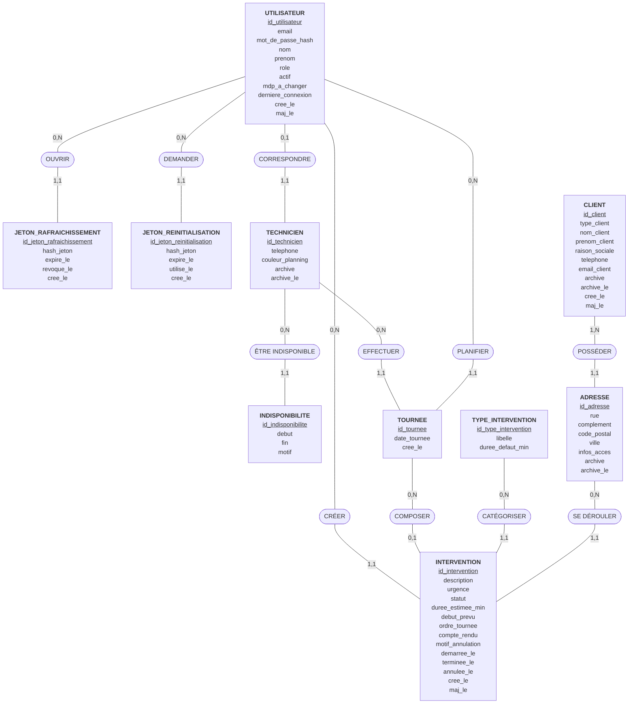
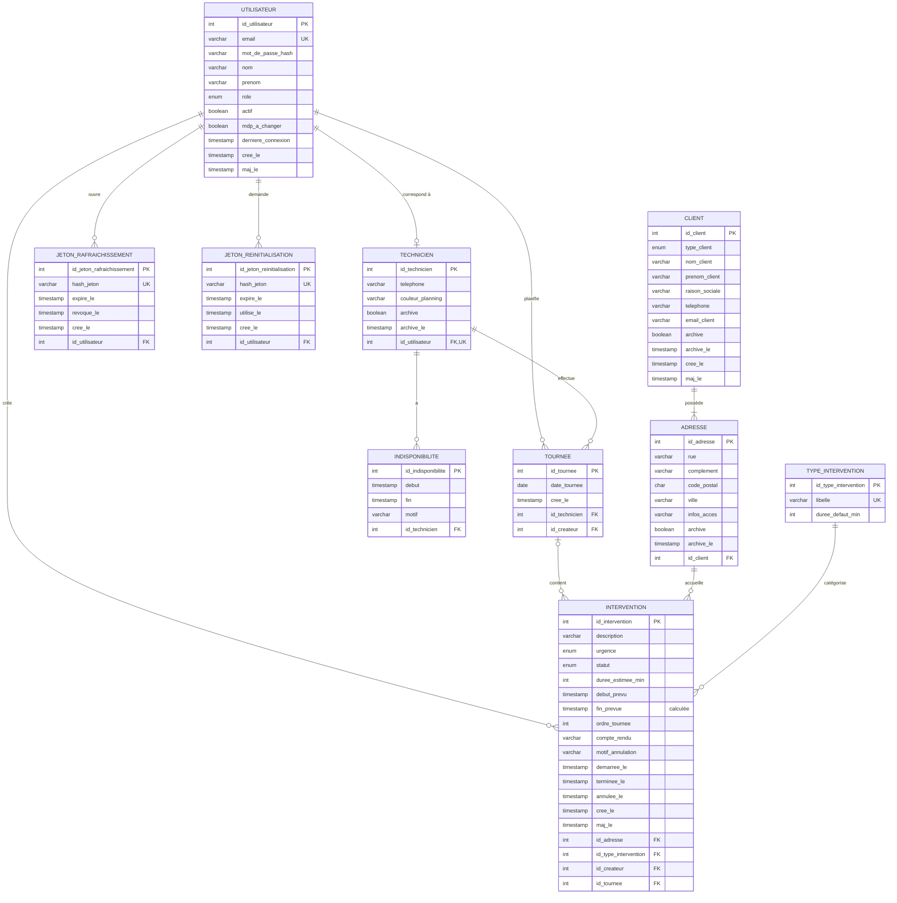

# Modèle de données — Plumbly

Ce document présente la conception des données de Plumbly. Les données métier sont dans PostgreSQL et suivent la méthode Merise : règles de gestion des données, dictionnaire de données, MCD (modèle conceptuel) puis MLD (modèle logique). Le journal des actions est dans MongoDB (section 8). Le MLD sera traduit en `schema.prisma` dans la card #8, puis en tables PostgreSQL par les migrations Prisma.

| Partie du modèle | Responsable | Entités |
| --- | --- | --- |
| Comptes, interventions et journal | Loïc BOTSY | Utilisateur, jetons, intervention, type d'intervention, collection `journal_actions` |
| Clients, techniciens et tournées | Arnaud BIDEL | Client, adresse, technicien, indisponibilité, tournée |

La partie d'Arnaud est une première proposition, à valider par lui (voir [section 7](#7-points-à-valider)).

## 1. Règles de gestion des données

Ces règles découlent des [user stories](user-stories.md) et des règles de gestion du [cahier des charges](cahier-des-charges.md#5-règles-de-gestion). Elles fixent les cardinalités du MCD.

| N° | Règle | Conséquence dans le modèle |
| --- | --- | --- |
| D01 | Un utilisateur a un seul rôle : administrateur, gestionnaire ou technicien. | Attribut `role` (énumération) |
| D02 | Un technicien correspond à exactement un compte utilisateur ; un utilisateur est au plus un technicien. | Association 1,1 / 0,1 |
| D03 | Un utilisateur peut avoir plusieurs sessions ouvertes (plusieurs appareils), chacune avec son jeton de rafraîchissement révocable. | Entité Jeton de rafraîchissement |
| D04 | Une demande de réinitialisation de mot de passe produit un jeton à usage unique valable 30 minutes. | Entité Jeton de réinitialisation |
| D05 | Un client possède une ou plusieurs adresses ; une adresse appartient à un seul client. | Association 1,N / 1,1 |
| D06 | Une intervention a lieu à une seule adresse ; une adresse peut accueillir plusieurs interventions. Le client de l'intervention est celui de l'adresse. | Association 1,1 / 0,N ; pas de lien direct intervention → client |
| D07 | Une intervention a un seul type ; un type sert à plusieurs interventions. | Association 1,1 / 0,N |
| D08 | Une intervention est créée par un seul utilisateur (gestionnaire ou administrateur). | Association 1,1 / 0,N |
| D09 | Une intervention appartient à au plus une tournée ; une tournée contient zéro ou plusieurs interventions. | Association 0,1 / 0,N |
| D10 | Une tournée concerne un seul technicien et une seule date ; un technicien a au plus une tournée par date. | Association 1,1 / 0,N ; unicité (technicien, date) |
| D11 | Un technicien peut avoir plusieurs indisponibilités ; une indisponibilité concerne un seul technicien. | Association 0,N / 1,1 |
| D12 | Clients, adresses et techniciens liés à des interventions ne sont jamais supprimés : ils sont archivés. | Attributs `archive` et `archive_le` |
| D13 | Chaque action sensible (changement de statut, annulation, connexion, gestion de compte) est enregistrée dans un journal qui n'est jamais modifié. | Collection MongoDB `journal_actions` (section 8) |
| D14 | Une tournée est créée par un seul utilisateur (gestionnaire ou administrateur). | Association 1,1 / 0,N |

## 2. Dictionnaire de données

Types indiqués au niveau logique. Les identifiants sont des entiers auto-incrémentés.

### 2.1 Comptes (Loïc)

| Code | Libellé | Type | Contraintes | Entité |
| --- | --- | --- | --- | --- |
| id_utilisateur | Identifiant de l'utilisateur | Entier | Clé primaire | Utilisateur |
| email | Adresse e-mail de connexion | Texte (255) | Obligatoire, unique, format e-mail | Utilisateur |
| mot_de_passe_hash | Empreinte argon2 du mot de passe | Texte (255) | Obligatoire | Utilisateur |
| nom | Nom de famille | Texte (100) | Obligatoire | Utilisateur |
| prenom | Prénom | Texte (100) | Obligatoire | Utilisateur |
| role | Rôle | Énumération | ADMIN, GESTIONNAIRE, TECHNICIEN | Utilisateur |
| actif | Compte autorisé à se connecter | Booléen | Défaut : vrai | Utilisateur |
| mdp_a_changer | Mot de passe provisoire à changer | Booléen | Défaut : vrai | Utilisateur |
| derniere_connexion | Date de la dernière connexion | Date-heure | Facultatif | Utilisateur |
| cree_le | Date de création | Date-heure | Obligatoire | Utilisateur, Client, Intervention, Tournée, jetons |
| maj_le | Date de dernière modification | Date-heure | Obligatoire | Utilisateur, Client, Intervention |
| id_jeton_rafraichissement | Identifiant du jeton | Entier | Clé primaire | Jeton de rafraîchissement |
| hash_jeton | Empreinte du jeton (jamais le jeton en clair) | Texte (255) | Obligatoire, unique | Jetons |
| expire_le | Date d'expiration | Date-heure | Obligatoire | Jetons |
| revoque_le | Date de révocation | Date-heure | Facultatif | Jeton de rafraîchissement |
| id_jeton_reinitialisation | Identifiant du jeton | Entier | Clé primaire | Jeton de réinitialisation |
| utilise_le | Date d'utilisation | Date-heure | Facultatif | Jeton de réinitialisation |

### 2.2 Interventions (Loïc)

| Code | Libellé | Type | Contraintes | Entité |
| --- | --- | --- | --- | --- |
| id_intervention | Identifiant de l'intervention | Entier | Clé primaire | Intervention |
| description | Description du problème | Texte (1 000) | Obligatoire | Intervention |
| urgence | Niveau d'urgence | Énumération | NORMALE, PRIORITAIRE, URGENTE | Intervention |
| statut | Statut | Énumération | A_PLANIFIER, PLANIFIEE, EN_COURS, TERMINEE, ANNULEE ; défaut A_PLANIFIER | Intervention |
| duree_estimee_min | Durée estimée en minutes | Entier | Obligatoire, > 0 | Intervention |
| debut_prevu | Date et heure de début prévues | Date-heure | Obligatoire si planifiée | Intervention |
| ordre_tournee | Rang dans la tournée | Entier | ≥ 1 ; unique dans une tournée | Intervention |
| compte_rendu | Compte rendu du technicien | Texte (2 000) | Facultatif | Intervention |
| motif_annulation | Motif d'annulation | Texte (500) | Obligatoire si annulée | Intervention |
| demarree_le | Date de démarrage réelle | Date-heure | Facultatif | Intervention |
| terminee_le | Date de fin réelle | Date-heure | Facultatif | Intervention |
| annulee_le | Date d'annulation | Date-heure | Facultatif | Intervention |
| id_type_intervention | Identifiant du type | Entier | Clé primaire | Type d'intervention |
| libelle | Libellé du type | Texte (100) | Obligatoire, unique | Type d'intervention |
| duree_defaut_min | Durée par défaut en minutes | Entier | Obligatoire, > 0 | Type d'intervention |

| fin_prevue | Date et heure de fin prévues | Date-heure | **Colonne calculée** par PostgreSQL : `debut_prevu + duree_estimee_min` minutes ; jamais saisie | Intervention |

La fin prévue est une donnée dérivée : elle n'apparaît pas dans le MCD, mais elle est ajoutée au niveau logique comme **colonne générée** (`GENERATED ALWAYS AS … STORED`). PostgreSQL la recalcule à chaque modification : elle ne peut jamais contredire le début et la durée, et elle peut être indexée pour détecter les chevauchements de créneaux (RG09).

### 2.2 bis Signature d'intervention (US33, ADR 0013)

| Code | Libellé | Type | Contraintes | Entité |
| --- | --- | --- | --- | --- |
| id_intervention | Intervention signée | Entier | Clé primaire et clé étrangère vers `intervention` | Signature d'intervention |
| image | Image de la signature | Binaire (`BYTEA`) | Obligatoire, PNG, 48 Ko maximum | Signature d'intervention |
| nom_signataire | Nom de la personne qui signe | Texte (100) | Obligatoire, non vide | Signature d'intervention |
| signee_le | Date et heure serveur de la signature | Date-heure | Obligatoire, égale à `terminee_le` | Signature d'intervention |
| empreinte | Empreinte SHA-256 du contenu signé | Texte (64) | Obligatoire, 64 caractères hexadécimaux | Signature d'intervention |
| id_auteur | Compte qui a enregistré la signature | Entier | Clé étrangère vers `utilisateur` | Signature d'intervention |

La table est séparée d'`intervention` pour que les listes ne chargent jamais l'image. Une ligne n'est jamais mise à jour (déclencheur `BEFORE UPDATE`).

### 2.3 Clients, techniciens et tournées (Arnaud, à valider)

| Code | Libellé | Type | Contraintes | Entité |
| --- | --- | --- | --- | --- |
| id_client | Identifiant du client | Entier | Clé primaire | Client |
| type_client | Particulier ou professionnel | Énumération | PARTICULIER, PROFESSIONNEL | Client |
| nom_client | Nom du client (particulier) | Texte (100) | Obligatoire si particulier | Client |
| prenom_client | Prénom du client | Texte (100) | Facultatif | Client |
| raison_sociale | Raison sociale | Texte (150) | Obligatoire si professionnel | Client |
| telephone | Numéro de téléphone | Texte (20) | Obligatoire | Client, Technicien |
| email_client | E-mail du client | Texte (255) | Facultatif, format e-mail | Client |
| archive | Élément archivé | Booléen | Défaut : faux | Client, Adresse, Technicien |
| archive_le | Date d'archivage | Date-heure | Facultatif | Client, Adresse, Technicien |
| id_adresse | Identifiant de l'adresse | Entier | Clé primaire | Adresse |
| rue | Numéro et voie | Texte (255) | Obligatoire | Adresse |
| complement | Complément d'adresse | Texte (255) | Facultatif | Adresse |
| code_postal | Code postal | Texte (5) | Obligatoire, 5 chiffres | Adresse |
| ville | Ville | Texte (100) | Obligatoire | Adresse |
| infos_acces | Code d'accès, étage, interphone | Texte (500) | Facultatif | Adresse |
| id_technicien | Identifiant du technicien | Entier | Clé primaire | Technicien |
| couleur_planning | Couleur dans le planning | Texte (7) | Format `#RRGGBB` | Technicien |
| id_indisponibilite | Identifiant de l'indisponibilité | Entier | Clé primaire | Indisponibilité |
| debut | Début de l'indisponibilité | Date-heure | Obligatoire | Indisponibilité |
| fin | Fin de l'indisponibilité | Date-heure | Obligatoire, > début | Indisponibilité |
| motif | Motif (congés, absence…) | Texte (255) | Facultatif | Indisponibilité |
| id_tournee | Identifiant de la tournée | Entier | Clé primaire | Tournée |
| date_tournee | Jour de la tournée | Date | Obligatoire | Tournée |

## 3. MCD

### 3.1 Entités et associations

| Association | Entité A | Card. A | Entité B | Card. B | Règle |
| --- | --- | --- | --- | --- | --- |
| CORRESPONDRE | Technicien | 1,1 | Utilisateur | 0,1 | D02 |
| OUVRIR | Jeton de rafraîchissement | 1,1 | Utilisateur | 0,N | D03 |
| DEMANDER | Jeton de réinitialisation | 1,1 | Utilisateur | 0,N | D04 |
| POSSÉDER | Adresse | 1,1 | Client | 1,N | D05 |
| SE DÉROULER | Intervention | 1,1 | Adresse | 0,N | D06 |
| CATÉGORISER | Intervention | 1,1 | Type d'intervention | 0,N | D07 |
| CRÉER | Intervention | 1,1 | Utilisateur | 0,N | D08 |
| COMPOSER | Intervention | 0,1 | Tournée | 0,N | D09 |
| EFFECTUER | Tournée | 1,1 | Technicien | 0,N | D10 |
| PLANIFIER | Tournée | 1,1 | Utilisateur | 0,N | D14 |
| ÊTRE INDISPONIBLE | Indisponibilité | 1,1 | Technicien | 0,N | D11 |

Lecture : « une intervention se déroule à **une et une seule** adresse (1,1) ; une adresse accueille **zéro ou plusieurs** interventions (0,N) ».

### 3.2 Schéma

Le MCD est dessiné en Mermaid, affiché directement par GitHub et par l'aperçu Markdown de VS Code. Les entités sont des rectangles (identifiant souligné), les associations des formes arrondies, et les cardinalités sont inscrites sur chaque lien, côté entité.



Lecture d'un lien : la cardinalité est écrite du côté de l'entité qu'elle concerne. Par exemple, `ADRESSE —0,N— SE DÉROULER —1,1— INTERVENTION` se lit « une adresse accueille zéro ou plusieurs interventions ; une intervention se déroule à une et une seule adresse ».

## 4. MLD

### 4.1 Passage du MCD au MLD

Règles de transformation appliquées :

- chaque entité devient une table, son identifiant devient la clé primaire ;
- une association **1,1 / 0,N** (ou 1,N) disparaît : la table du côté 1,1 reçoit une clé étrangère vers l'autre table ;
- l'association **0,1 / 0,N** COMPOSER devient une clé étrangère **facultative** `id_tournee` dans `intervention` ;
- l'association **1,1 / 0,1** CORRESPONDRE devient une clé étrangère **unique** `id_utilisateur` dans `technicien`.

Aucune association n'est de type N,N : aucune table de jointure n'est nécessaire.

### 4.2 Schéma relationnel

Notation : nom de table en italique, clé primaire en **gras**, clé étrangère précédée de `#`.

- *utilisateur* (**id_utilisateur**, email, mot_de_passe_hash, nom, prenom, role, actif, mdp_a_changer, derniere_connexion, cree_le, maj_le)
- *jeton_rafraichissement* (**id_jeton_rafraichissement**, hash_jeton, expire_le, revoque_le, cree_le, #id_utilisateur)
- *jeton_reinitialisation* (**id_jeton_reinitialisation**, hash_jeton, expire_le, utilise_le, cree_le, #id_utilisateur)
- *technicien* (**id_technicien**, telephone, couleur_planning, archive, archive_le, #id_utilisateur)
- *indisponibilite* (**id_indisponibilite**, debut, fin, motif, #id_technicien)
- *client* (**id_client**, type_client, nom_client, prenom_client, raison_sociale, telephone, email_client, archive, archive_le, cree_le, maj_le)
- *adresse* (**id_adresse**, rue, complement, code_postal, ville, infos_acces, archive, archive_le, #id_client)
- *type_intervention* (**id_type_intervention**, libelle, duree_defaut_min)
- *tournee* (**id_tournee**, date_tournee, cree_le, #id_technicien, #id_createur)
- *intervention* (**id_intervention**, description, urgence, statut, duree_estimee_min, debut_prevu, fin_prevue, ordre_tournee, compte_rendu, motif_annulation, demarree_le, terminee_le, annulee_le, cree_le, maj_le, #id_adresse, #id_type_intervention, #id_createur, #id_tournee)
- *signature_intervention* (**#id_intervention**, image, nom_signataire, signee_le, empreinte, #id_auteur)

Dans `intervention` et `tournee`, `#id_createur` référence `utilisateur(id_utilisateur)`. Dans `intervention`, `fin_prevue` est une colonne calculée. `#id_tournee` peut être vide (intervention non planifiée).

### 4.3 Diagramme



## 5. Contraintes d'intégrité et index

### 5.1 Contraintes portées par la base

| Table | Contrainte | Type | Règle |
| --- | --- | --- | --- |
| utilisateur | `email` unique | UNIQUE | Un e-mail par compte |
| technicien | `id_utilisateur` unique | UNIQUE | D02 |
| tournee | (`id_technicien`, `date_tournee`) unique | UNIQUE | D10 : une tournée par technicien et par jour |
| intervention | (`id_tournee`, `ordre_tournee`) unique, **différée** | UNIQUE DEFERRABLE | Ordre unique dans une tournée, vérifié en fin de transaction pour permettre le réordonnancement |
| intervention | `duree_estimee_min > 0` | CHECK | Durée positive |
| intervention | `ordre_tournee >= 1` | CHECK | Rang à partir de 1 |
| intervention | statut PLANIFIEE, EN_COURS ou TERMINEE ⇒ `id_tournee` et `debut_prevu` renseignés | CHECK | Une intervention planifiée est dans une tournée |
| intervention | statut ANNULEE ⇒ `motif_annulation` renseigné | CHECK | Motif d'annulation obligatoire |
| indisponibilite | `fin > debut` | CHECK | Période valide |
| client | PARTICULIER ⇒ `nom_client` renseigné ; PROFESSIONNEL ⇒ `raison_sociale` renseignée | CHECK | Identité du client |
| toutes | Clés étrangères en `ON DELETE RESTRICT` | FOREIGN KEY | D12 : on archive au lieu de supprimer |
| jetons | Clé étrangère en `ON DELETE CASCADE` | FOREIGN KEY | Les jetons disparaissent avec le compte |
| signature_intervention | `octet_length(image) <= 49152` ; `empreinte ~ '^[0-9a-f]{64}$'` ; `btrim(nom_signataire) <> ''` | CHECK | RG35, RG34, RG31 |
| signature_intervention | Mise à jour refusée | TRIGGER `BEFORE UPDATE` | RG32 : une signature est définitive. La suppression reste permise (anonymisation RGPD) : une suppression suivie d'une nouvelle insertion n'est pas détectée par l'empreinte (ADR 0013) |

Prisma ne gère pas directement les contraintes `CHECK`, les contraintes `DEFERRABLE` ni les colonnes générées : elles seront ajoutées en SQL dans la migration générée par Prisma (card #8).

### 5.2 Règles vérifiées par l'application

Certaines règles portent sur plusieurs lignes ou plusieurs tables. Elles sont vérifiées dans les services NestJS et couvertes par les tests d'intégration :

- pas de chevauchement de créneaux entre deux interventions d'un même technicien ;
- pas d'affectation pendant une indisponibilité du technicien ;
- transitions de statut autorisées uniquement : à planifier → planifiée → en cours → terminée, retour de planifiée à « à planifier » (retrait de la tournée), et annulation depuis « à planifier », « planifiée » ou « en cours » ; « terminée » et « annulée » sont définitives (table unique dans `backend/src/interventions/cycle-de-vie.ts`) ;
- créneaux entre 7 h et 19 h, du lundi au samedi ;
- un client garde au moins une adresse non archivée.

### 5.3 Index

| Table | Colonnes | Utilisation |
| --- | --- | --- |
| intervention | `statut`, `urgence` | Liste « à planifier », urgences en tête |
| intervention | `id_tournee`, `ordre_tournee` | Tournée du jour dans l'ordre (index créé par la contrainte unique) |
| intervention | `id_adresse` | Historique d'un client |
| tournee | `date_tournee` | Planning jour / semaine |
| client | `nom_client`, `raison_sociale`, `telephone` | Recherche de client |
| adresse | `ville` | Recherche de client par ville |
| indisponibilite | `id_technicien`, `debut`, `fin` | Contrôle des conflits de planning |

## 6. Choix de modélisation

| Choix | Justification |
| --- | --- |
| Intervention liée à l'**adresse**, pas directement au client | Le client se retrouve par l'adresse. Un lien direct créerait une redondance et un risque d'incohérence (intervention chez le client A à une adresse du client B) : respect de la 3ᵉ forme normale. |
| **Technicien** séparé de l'utilisateur | Seuls les techniciens ont un téléphone professionnel, une couleur de planning, des indisponibilités et des tournées. Les autres rôles n'ont pas ces champs vides. |
| **Fin prévue en colonne générée** | Compromis entre la proposition d'Arnaud (fin stockée) et la mienne (fin calculée) : la valeur est stockée, donc indexable et simple à utiliser dans la règle de chevauchement (RG09), mais c'est PostgreSQL qui la calcule, donc elle ne peut pas contredire le début et la durée. |
| **Pas de statut de tournée** | Le statut d'une tournée se déduit de celui de ses interventions (aucune démarrée, en cours, toutes terminées). Le stocker créerait une donnée redondante à tenir à jour, avec un risque d'incohérence. Il sera calculé à l'affichage. |
| **Créateur de la tournée** conservé | Repris de la proposition d'Arnaud, par cohérence avec le créateur de l'intervention ; il permet d'afficher qui a organisé la journée. |
| **Jetons stockés hachés** | Un vol de la base ne permet pas de réutiliser les jetons, comme pour les mots de passe (ADR 0007). |
| **Archivage** plutôt que suppression | Les interventions passées gardent leur client, leur adresse et leur technicien (D12). |
| **Type d'intervention** en table, pas en énumération | Les types et leurs durées par défaut peuvent évoluer sans migration. |
| Énumérations pour `role`, `statut`, `urgence`, `type_client` | Liste fermée, contrôlée par la base et par Prisma. |
| Pas de **compétences** des techniciens | US13 est en Could : hors MVP. Une table `competence` et une table de jointure seront ajoutées si besoin. |
| **Historique des statuts** dans MongoDB, pas en table SQL | Le journal ne fait qu'ajouter des documents dont le contenu varie selon l'action ; il n'alourdit pas la base métier (ADR 0006). Les dates `demarree_le`, `terminee_le` et `annulee_le` restent dans `intervention` pour les statistiques SQL du tableau de bord. |

## 7. Points à valider

- [ ] **Partie d'Arnaud** : client, adresse, technicien, indisponibilité et tournée (sections 2.3 et 3).
- [x] **Journal des actions** : réintroduit dans MongoDB (ADR 0006 acceptée), comme dans la branche `docs/correction-cahier-des-charges` d'Arnaud.
- [x] **Statut de tournée** : non stocké, déduit des interventions ; le créateur de la tournée est conservé (section 6).
- [x] **Fin prévue** : colonne générée par PostgreSQL (section 2.2).
- [ ] **Rendu du MCD** : vérifier l'affichage du schéma Mermaid sur GitHub et ajuster la disposition si besoin.

## 8. Données NoSQL : journal des actions

Le journal des actions est stocké dans MongoDB, dans la collection `journal_actions` (voir [ADR 0006](adr/0006-mongodb-pour-le-journal-des-actions.md)). Chaque document décrit une action ; les documents sont ajoutés, jamais modifiés ni supprimés par l'application.

### 8.1 Structure d'un document

| Champ | Type | Obligatoire | Description |
| --- | --- | --- | --- |
| `_id` | ObjectId | Oui | Identifiant généré par MongoDB |
| `date` | Date | Oui | Date et heure de l'action |
| `action` | Chaîne | Oui | Type d'action : `STATUT_MODIFIE`, `INTERVENTION_ANNULEE`, `SIGNATURE_ENREGISTREE` (empreinte dans `contexte`, ni image ni nom du signataire), `CONNEXION_REUSSIE`, `CONNEXION_ECHOUEE`, `COMPTE_CREE`, `COMPTE_DESACTIVE`, `ACCES_REFUSE` (requête refusée en 403 ; méthode et modèle de route dans `contexte`), `EXPORT_CSV` (ressource, nombre de lignes et nom des filtres dans `contexte`) |
| `auteur` | Objet | Non | Utilisateur qui a agi : `{ id, role }` ; absent pour une connexion échouée |
| `entite` | Objet | Oui | Élément concerné : `{ type, id }`, par exemple `{ "type": "intervention", "id": 42 }` ; `id` vaut `null` pour une connexion échouée sur un e-mail qui ne correspond à aucun compte (`{ "type": "utilisateur", "id": null }`) ; pour un accès refusé, l'utilisateur refusé (`{ "type": "utilisateur", "id": 7 }`) |
| `avant` | Objet | Non | Valeurs modifiées avant l'action |
| `apres` | Objet | Non | Valeurs modifiées après l'action |
| `contexte` | Objet | Non | Informations propres à l'action (motif d'annulation, méthode et modèle de route d'un accès refusé…) |

Exemple de document pour un changement de statut :

```json
{
  "_id": "6741f0c2a1b2c3d4e5f60718",
  "date": "2026-11-24T10:05:12.000Z",
  "action": "STATUT_MODIFIE",
  "auteur": { "id": 7, "role": "TECHNICIEN" },
  "entite": { "type": "intervention", "id": 42 },
  "avant": { "statut": "PLANIFIEE" },
  "apres": { "statut": "EN_COURS" }
}
```

Exemple de document pour un accès refusé (un technicien qui veut démarrer l'intervention d'un collègue) :

```json
{
  "_id": "6741f0c2a1b2c3d4e5f60719",
  "date": "2026-11-24T10:06:40.000Z",
  "action": "ACCES_REFUSE",
  "auteur": { "id": 9, "role": "TECHNICIEN" },
  "entite": { "type": "utilisateur", "id": 9 },
  "contexte": { "methode": "POST", "route": "/api/v1/interventions/:id/start" }
}
```

Pour `EXPORT_CSV`, l'entité est l'auteur (l'export porte sur une liste et ne cite aucun client), et `contexte` vaut par exemple `{ "ressource": "interventions", "lignes": 128, "filtres": ["statut", "du", "au"] }` : le nom des filtres, jamais leur valeur.

### 8.2 Règles

- Le lien avec PostgreSQL se fait par les identifiants copiés (`auteur.id`, `entite.id`) : il n'y a pas de jointure entre les deux bases.
- Aucun mot de passe, jeton ni donnée personnelle complète n'est enregistré ; une connexion échouée ne garde que l'e-mail saisi masqué (`k***@exemple.fr`).
- Un accès refusé (403, par le contrôle des rôles ou par un contrôle de propriété dans un service) est tracé par un filtre d'exception global, sans changer la réponse. Seul le modèle de route est gardé (`/api/v1/interventions/:id/start`), jamais l'URL reçue ni sa chaîne de requête : une recherche peut contenir un nom de client. Un 401 n'est pas tracé : sans utilisateur, il n'y a pas d'auteur.
- L'écriture dans le journal ne doit pas bloquer l'action métier : une erreur MongoDB est signalée dans les logs de l'API, mais le changement de statut reste enregistré dans PostgreSQL.

### 8.3 Index

| Index | Utilisation |
| --- | --- |
| `{ "entite.type": 1, "entite.id": 1, "date": -1 }` | Historique d'une intervention, du plus récent au plus ancien (US19) |
| `{ "auteur.id": 1, "date": -1 }` | Actions d'un utilisateur |
| `{ "action": 1, "date": -1 }` | Suivi des connexions échouées |
| `{ "date": 1 }`, TTL de 6 mois, partiel sur `action` ∈ { `CONNEXION_REUSSIE`, `CONNEXION_ECHOUEE`, `ACCES_REFUSE` } (index `expiration_journaux_d_acces`) | Suppression automatique des journaux d'accès (connexions et accès refusés) après 6 mois (fourchette de 6 mois à 1 an recommandée par la CNIL) ; l'historique des statuts et des comptes est conservé (US19) |

Les index sont créés par l'API à son démarrage (`createIndexes`, rejouable), ou à la première écriture si MongoDB était éteint au démarrage. La durée est la constante `DUREE_CONSERVATION_JOURNAUX_D_ACCES_EN_SECONDES` de `backend/src/journal/journal.repository.ts`.

Une base créée avant l'ajout de `ACCES_REFUSE` garde l'ancien index `expiration_connexions` à côté du nouveau : il ne gêne pas (même durée), mais il est redondant. Pour le retirer : `db.journal_actions.dropIndex('expiration_connexions')` dans `mongosh`, ou `docker compose down -v` pour repartir d'une base vide.
